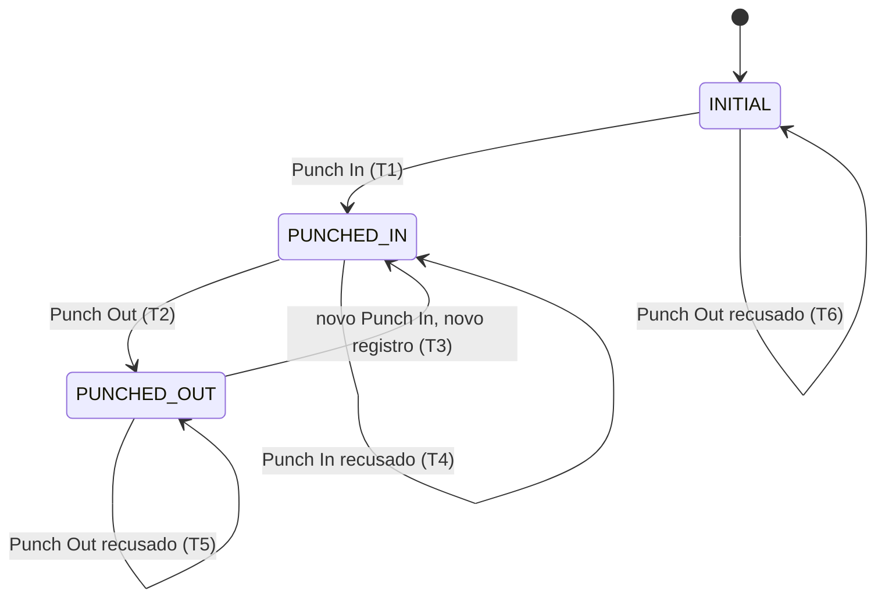

# Jornada de usuário: funcionário registra entrada e saída (Time › Attendance › Punch In / Punch Out)

> Issue: #16
> Versão analisada: OrangeHRM 5.9, repositório `orangehrm/orangehrm`, commit
> `56e23b3b09e7af29317a0943523b825843fff527` (29/06/2026). Servidor de demonstração:
> <https://opensource-demo.orangehrmlive.com/>.
> As regras abaixo foram lidas no código-fonte, na tabela de transições de estado do banco instalado localmente e na
> tela do demo (só leitura). O que não pôde ser confirmado está marcado como **a confirmar** e vira caso exploratório.

## 1. História de usuário

**Como** funcionário,
**quero** registrar minha entrada (Punch In) e minha saída (Punch Out),
**para que** minhas horas trabalhadas fiquem registradas e consultáveis em *My Records*.

### Critérios de aceitação (Given / When / Then)

| ID | Critério |
|----|----------|
| CA1 | **Dado** que estou autenticado e não tenho registro em aberto, **quando** abro *Punch In* e clico em **In**, **então** é criado um registro no estado `PUNCHED IN`, com a data/hora e o fuso informados, e a tela passa a oferecer *Punch Out*. |
| CA2 | **Dado** que tenho um registro `PUNCHED IN`, **quando** abro *Punch Out* e clico em **Out**, **então** o registro passa a `PUNCHED OUT`, com a data/hora de saída, e aparece em *My Records*. |
| CA3 | **Dado** o formulário aberto, **quando** informo uma nota de até 250 caracteres, **então** ela é gravada; com 251 caracteres a nota é rejeitada e nada é gravado. |
| CA4 | **Dado** que já tenho um registro `PUNCHED IN`, **quando** tento registrar nova entrada, **então** o sistema recusa com "Cannot Proceed Punch In Employee Already Punched In" e não cria outro registro. |
| CA5 | **Dado** que não tenho registro `PUNCHED IN`, **quando** tento registrar saída, **então** o sistema recusa com "Cannot Proceed Punch Out Employee Already Punched Out". |
| CA6 | **Dado** um registro `PUNCHED IN`, **quando** informo uma saída anterior à entrada, **então** o sistema recusa com "Punch Out Time Should Be Later Than Punch In Time". |
| CA7 | **Dado** um registro já concluído, **quando** informo uma entrada que cai dentro do intervalo dele, **então** o sistema recusa por sobreposição ("Punch-In Overlap Found" na API; "Overlapping Records Found" no campo de hora da tela). |
| CA8 | **Dado** que a opção "Employee can change current time when punching in/out" está **desligada**, **quando** abro o formulário, **então** data e hora ficam desabilitadas; e uma hora que difere da do servidor em 180 segundos ou mais é recusada com "Provided Date And Time Invalid". |
| CA9 | **Dado** um fuso horário (offset e nome) inválido, **quando** envio o registro, **então** ele é rejeitado e nada é gravado. |

## 2. Atores e pré-condições

- **Ator principal:** funcionário com usuário no sistema (papel *ESS*). Na tabela de transições do banco instalado,
  o papel ESS só tem duas ações do fluxo de Attendance: `PUNCH IN` (a partir de `INITIAL`) e `PUNCH OUT` (a partir
  de `PUNCHED IN`).
- **Ator secundário (fora do escopo):** Admin e Supervisor, que podem registrar ponto de outros funcionários
  (ações *proxy*) e editar/excluir registros.
- **Pré-condições:** usuário autenticado e vinculado a um funcionário; fuso horário disponível; para o fluxo
  alternativo A1, a opção de configuração ligada.
- **Pós-condição de sucesso:** registro em `ohrm_attendance_record` com o estado, os horários (UTC e do usuário), o
  *offset* e o nome do fuso e as notas.

## 3. Campos e regras (confirmados no código)

| Campo | Obrigatório | Regra | Onde está a regra |
|---|---|---|---|
| Date | Sim | data no formato da API (`Rules::API_DATE`); a tela valida o formato de data configurado | `EmployeeAttendanceRecordAPI::getCommonValidationRules`; `RecordAttendance.vue` |
| Time | Sim | formato `H:i` na API; na tela, validação assíncrona de sobreposição | `Rules::TIME ['H:i']`; `RecordAttendance.vue::validateDate` |
| Timezone offset | Sim | numérico entre **-12,00 e 14,00** | `Rules/TimezoneOffset.php` |
| Timezone name | Sim | nome aceito por `DateTimeZone` | `Rules/TimezoneName.php` |
| Note | Não | texto de até **250** caracteres | `EmployeeAttendanceRecordAPI::PARAMETER_RULE_NOTE_MAX_LENGTH`; `shouldNotExceedCharLength(250)` na tela |

**Máquina de estados (tabela `ohrm_workflow_state_machine`, fluxo de Attendance, instalação limpa do commit):**

| Papel | Estado atual | Ação | Estado resultante |
|---|---|---|---|
| ESS | `INITIAL` | Punch In | `PUNCHED IN` |
| ESS | `PUNCHED IN` | Punch Out | `PUNCHED OUT` |
| Admin | `INITIAL` | Proxy Punch In | `PUNCHED IN` |
| Admin | `PUNCHED IN` | Proxy Punch Out | `PUNCHED OUT` |

(Admin tem ainda as ações de edição e exclusão de registros, que não fazem parte desta jornada.)

**Regras de negócio relevantes:**

- A entrada é recusada se o **último** registro do funcionário está `PUNCHED IN` (`AttendanceDao`).
- Entrada sobrepõe um registro concluído quando `punchIn <= nova entrada` e `punchOut > nova entrada`: a nova entrada
  igual à saída anterior **não** é sobreposição, e igual à entrada anterior **é**.
- Saída é recusada se a entrada registrada é **posterior** à saída (`punchIn > punchOut`). Saída igual à entrada não
  cai nessa regra; o comportamento nesse caso é **a confirmar**.
- **Navegação:** `PunchInController` redireciona `/attendance/punchIn` para `/attendance/punchOut` quando o último
  registro está `PUNCHED IN`, e `PunchOutController` faz o inverso quando não há registro `PUNCHED IN`. Pela
  interface, portanto, o funcionário não chega às exceções E1 e E2; elas só são alcançáveis pela API.
- Com a opção de "alterar hora atual" desligada, a hora informada precisa estar a **menos de 180 s** da hora do
  servidor no fuso do usuário (diferença estritamente entre -180 e 180).

## 4. Fluxo principal (FP)

1. O funcionário autenticado abre **Time › Attendance › Punch In/Out**.
2. O sistema mostra Date, Time e Note, já preenchidos com a data e a hora atuais, e o botão **In**.
3. O funcionário (opcionalmente) escreve uma nota e clica em **In**.
4. O sistema valida, grava o registro `PUNCHED IN` e recarrega a tela, que agora mostra o horário de entrada e o
   botão **Out**.
5. Mais tarde, o funcionário clica em **Out** (opcionalmente com uma nota).
6. O sistema grava a saída, passa o registro a `PUNCHED OUT` e o registro aparece em **My Records**.

## 5. Fluxos alternativos

| ID | Descrição |
|---|---|
| A1 | Com "Employee can change current time" ligada, o funcionário altera data e hora (por exemplo, uma entrada retroativa) antes de clicar em **In**. |
| A2 | O funcionário escolhe outro fuso horário na lista antes de registrar. |
| A3 | O funcionário registra uma nova entrada depois de uma saída: é criado um **novo** registro (transição `PUNCHED OUT` → novo `PUNCHED IN`). |

## 6. Exceções

| ID | Situação | Resposta esperada |
|---|---|---|
| E1 | Entrada com o último registro `PUNCHED IN` | "Cannot Proceed Punch In Employee Already Punched In" |
| E2 | Saída sem registro `PUNCHED IN` | "Cannot Proceed Punch Out Employee Already Punched Out" |
| E3 | Saída anterior à entrada | "Punch Out Time Should Be Later Than Punch In Time" |
| E4 | Entrada dentro de um registro concluído | "Punch-In Overlap Found" (API) / "Overlapping Records Found" (tela) |
| E5 | Saída que engloba outro registro | "Punch-Out Overlap Found" |
| E6 | Hora fora da margem de 180 s com a opção desligada | "Provided Date And Time Invalid" |
| E7 | Fuso inválido | "Valid Timezone Offset and Timezone Name Must Be Provided" (mensagem registrada nos testes originais) ou erro de parâmetro |
| E8 | Nota com mais de 250 caracteres | erro de validação no campo |
| E9 | Campo obrigatório vazio (data ou hora) | "Required" |

## 7. Pontos de risco observados na leitura do código

| ID | Observação | Como será verificado |
|---|---|---|
| R1 | Em `MyAttendanceRecordAPI`, os métodos `userAllowedPunchInActions` e `userAllowedPunchOutActions` calculam `$allowed` com `in_array(...)`, mas **não usam o resultado nem lançam exceção**. Ao ler o código, a checagem de permissão parece não ter efeito nesse endpoint. | IT-10: retirar a ação de Punch In do papel no banco de teste e tentar registrar entrada. Se o sistema aceitar, R1 se confirma como defeito. |
| R2 | `create()` (entrada) abre transação e usa leitura com bloqueio; `update()` (saída) **não** abre transação. | Não coberto por caso de teste: exige concorrência real. Registrado como limitação. |
| R3 | Saída **igual** à entrada: a regra só rejeita entrada posterior à saída. | IT-05: caso exploratório. |

## 8. Diagrama de estados

Em `INITIAL` não existe registro; `PUNCHED IN` e `PUNCHED OUT` são os estados gravados no registro.

## Fontes

- `src/plugins/orangehrmAttendancePlugin/` do commit `56e23b3`: `Api/EmployeeAttendanceRecordAPI.php`,
  `Api/MyAttendanceRecordAPI.php`, `Dao/AttendanceDao.php`, `Exception/AttendanceServiceException.php`.
- `src/plugins/orangehrmCorePlugin/Api/V2/Validator/Rules/TimezoneOffset.php` e `TimezoneName.php`.
- `src/client/src/orangehrmAttendancePlugin/components/RecordAttendance.vue`.
- Tabela `ohrm_workflow_state_machine` (fluxo 1) do banco `orangehrm_dev` instalado pelo ambiente
  `eduardo-hoffmann/ambiente`, e `installer/Migration/V5_0_0/lang-string/attendance.yaml`.
- Exploração do demo registrada em [`../analise/01-analise-critica.md`](../analise/01-analise-critica.md), seção 7.
