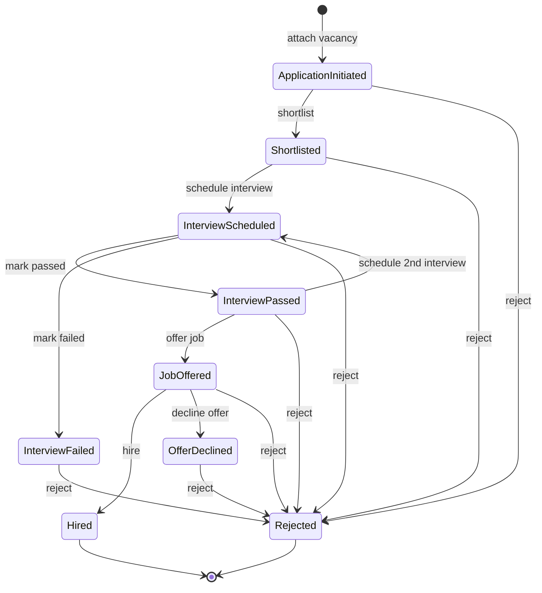

# Jornada de usuário: "Recrutador contrata um candidato"

## Persona

**Ana, analista de RH (recrutadora).** Usa o OrangeHRM com papel **Admin**. Abre uma vaga, recebe
currículos e conduz cada candidato pelas etapas do processo seletivo até a contratação. Não é técnica;
espera que o sistema avise quando um dado está errado e que não permita pular etapas.

## História de usuário

> **Como** recrutadora,
> **quero** cadastrar um candidato para uma vaga e registrar cada etapa do processo seletivo,
> **para que** a contratação fique documentada e o novo funcionário já apareça no cadastro de pessoal (PIM).

### Critérios de aceitação

| ID | Critério |
|---|---|
| CA1 | O candidato só é salvo com primeiro nome, sobrenome e e-mail válidos; nomes até 30 caracteres. |
| CA2 | Ao salvar com uma vaga, o candidato fica no status **Application Initiated**. |
| CA3 | Cada etapa só pode ser executada a partir dos status permitidos pela máquina de estados (abaixo). |
| CA4 | Uma entrevista exige título, data e de 1 a 5 entrevistadores; no máximo 2 entrevistas por candidato e vaga. |
| CA5 | Ao contratar (**Hire**), o candidato passa a **Hired** e é criado um funcionário com o mesmo nome. |
| CA6 | Em vaga fechada, nenhuma ação pode ser executada sobre o candidato. |
| CA7 | Cada ação fica registrada no histórico do candidato. |

## Passos da jornada (caminho principal)

| # | Ana faz | Tela / endpoint | O sistema responde |
|---|---|---|---|
| 1 | Faz login | `/auth/login` | Painel inicial |
| 2 | Abre **Recruitment › Candidates › Add** | `/recruitment/addCandidate` – `POST /api/v2/recruitment/candidates` | Formulário; ao salvar, perfil do candidato com status *Application Initiated* |
| 3 | Clica **Shortlist** e salva | `/recruitment/changeCandidateVacancyStatus` – `PUT .../shortlist` | Status *Shortlisted* |
| 4 | Clica **Schedule Interview**, informa título, entrevistador e data | `POST .../shedule-interview` | Status *Interview Scheduled* |
| 5 | Clica **Mark Interview Passed** | `PUT .../interviews/{id}/pass` | Status *Interview Passed* |
| 6 | Clica **Offer Job** | `PUT .../job/offer` | Status *Job Offered* |
| 7 | Clica **Hire** | `PUT .../hire` | Status *Hired*; funcionário criado no PIM |

Caminhos alternativos: **Reject** (em qualquer etapa não final), **Mark Interview Failed**,
**Decline Offer** e segunda entrevista após *Interview Passed*.

## Máquina de estados (papel Admin)

Extraída do script de instalação `installer/Migration/V3_3_3/dbscript-2.sql`
(tabela `ohrm_workflow_state_machine`, `workflow = 2`).

Regra extra, no código (`CandidateInterviewSchedulingAPI`, `CandidateAllowedActionAPI`): com 2 entrevistas
já agendadas, "schedule interview" deixa de ser permitido mesmo em *Shortlisted* ou *Interview Passed*.

## Por que esta jornada

- É o processo de negócio central do módulo Recruitment e atravessa três camadas (tela Vue, API REST, banco)
  e dois módulos (Recruitment e PIM).
- Tem uma máquina de estados explícita, boa para a técnica de **transição de estados**, e formulários com
  limites claros, bons para **partição de equivalência** e **valor-limite**.
- A análise crítica (`analise/01-analise-critica.md`) mostrou que é justamente onde os testes originais têm
  mais lacunas.
- Não foi escolhida por nenhum colega da turma até a data desta escolha.
