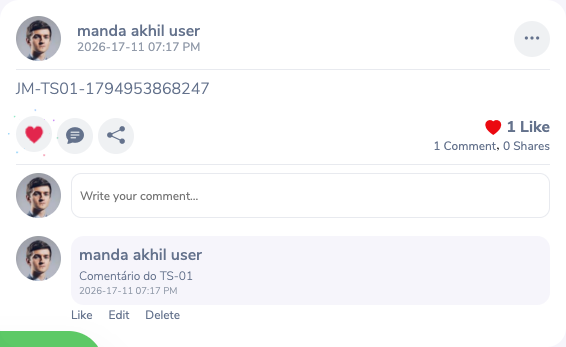
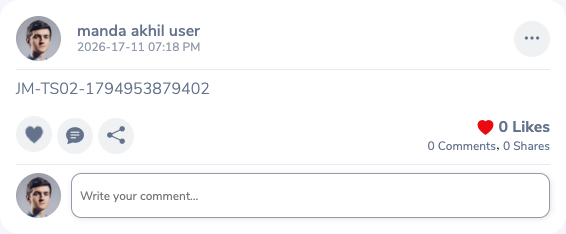
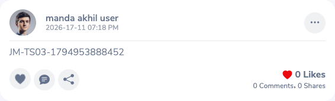
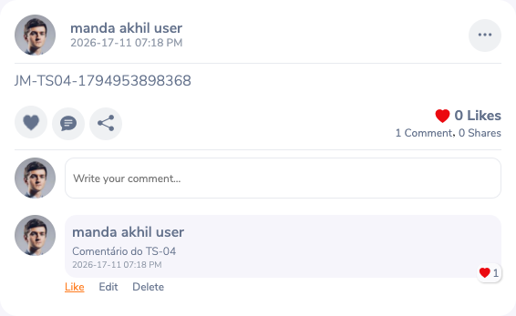
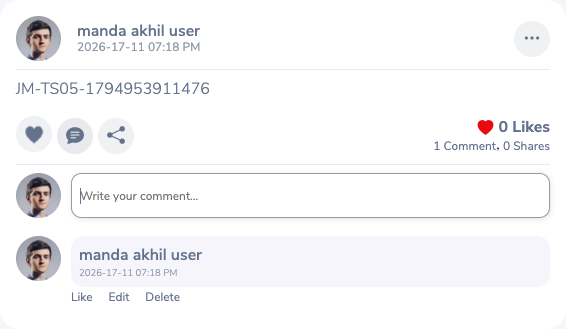

# Relatório da execução dos testes

Issues: #51 (e #58 para os casos de curtidas)

Data: 17/11/2026, servidor de demonstração (OrangeHRM OS 5.9).
Ambiente: macOS, Java 26 (compilando para 21), Maven 3.9, Node 24, Chrome.
As saídas completas estão em [`../resultados/`](../resultados).

## Resultado

| Nível | Casos | Execuções | Passaram | Falharam |
|---|---|---|---|---|
| Unitário | TU-01 a TU-07 | 12 | 12 | 0 |
| Integração | TI-01 a TI-09 e TI-11 a TI-13 | 12 | 12 | 0 |
| Integração (tag `defeito`) | TI-10 | 1 | 0 | 1 |
| Sistema | TS-01 a TS-04 | 4 | 4 | 0 |
| Sistema (pasta `defeito`) | TS-05 | 1 | 0 | 1 |

Há mais execuções do que casos nos unitários porque o TU-01 é parametrizado (5 valores-limite, 5 execuções) e o
TU-06 tem 2 métodos (token encontrado e token ausente): 5 + 1 + 1 + 1 + 1 + 2 + 1 = 12.

Depois da execução conferi o feed pela API e não sobrou nenhum post com o prefixo `JM-`.

Trecho da saída do Maven (unitários e integração), completa em `resultados/unitario-integracao.txt`:

```
[INFO] Running buzz.BuzzApiTest
[INFO] Tests run: 12, Failures: 0, Errors: 0, Skipped: 0 -- in buzz.BuzzApiTest
[INFO] Tests run: 2, Failures: 0, Errors: 0, Skipped: 0 -- in buzz.TokenCsrfTest
[INFO] Tests run: 7, Failures: 0, Errors: 0, Skipped: 0 -- in buzz.RegraTextoTest
[INFO] Tests run: 3, Failures: 0, Errors: 0, Skipped: 0 -- in buzz.FeedTest
[INFO] Tests run: 24, Failures: 0, Errors: 0, Skipped: 0
[INFO] BUILD SUCCESS
```

Trecho da saída das gravações (sistema), completa em `resultados/sistema.txt`:

```
PASSOU  TS-01 publicar, comentar, curtir e excluir um post no Buzz
PASSOU  TS-02 comentário vazio não é enviado pela tela
PASSOU  TS-03 cancelar a exclusão mantém o post no feed
PASSOU  TS-04 curtir e descurtir o post e curtir um comentário
4 de 4 gravações passaram
```

## Evidências dos testes de sistema

As imagens foram tiradas pelo próprio script durante a execução. Cada uma mostra só o card do post que o teste
criou (o texto `JM-TS0X-<número>` identifica a execução), no momento logo antes de o teste excluir o post.

### TS-01 – jornada completa

O teste fez login, entrou no Buzz, publicou o post, abriu os comentários, comentou e curtiu.



O post aparece no feed com o coração marcado, **"1 Like"** e **"1 Comment"**, e o comentário "Comentário do
TS-01" aparece abaixo dele. Depois desta imagem o teste excluiu o post e confirmou que ele sumiu do feed.

### TS-02 – comentário vazio pela tela

O teste publicou o post, abriu o campo de comentário e apertou Enter sem escrever nada.



O campo continua vazio, o contador segue em **"0 Comments"** e nenhum comentário foi criado: a tela bloqueia o
comentário vazio.

### TS-03 – cancelar a exclusão

O teste abriu o menu do post, escolheu **Delete Post** e, na confirmação, clicou em **No, Cancel**.



O post continua no feed. Só depois desta imagem o teste repetiu a exclusão confirmando com **Yes, Delete**.

### TS-04 – curtidas

O teste curtiu o post, clicou de novo no coração para descurtir, comentou e curtiu o comentário.



O post voltou para **"0 Likes"** (a curtida foi desfeita) e o comentário mostra o coração com **1** curtida e o
"Like" marcado.

## Defeito encontrado

### D1 – API aceita comentário vazio

- **Onde:** `POST /api/v2/buzz/shares/{shareId}/comments`
- **Passos:** criar um post e enviar `{"text": ""}` como comentário.
- **Esperado:** 422, como acontece com o post vazio (TI-02) e com o comentário sem o campo `text` (TI-09).
  Na tela não dá para enviar comentário vazio (TS-02).
- **Obtido:** 200, e o comentário vazio é gravado (o contador de comentários aumenta).
- **Causa provável:** em `BuzzCommentAPI::getValidationRuleForCreate()` a regra do `text` tem só
  `STRING_TYPE` e `STR_LENGTH [null, 65530]`. Falta o `Rules::REQUIRED`, que existe na regra do post
  (`BuzzPostAPI::getTextValidationRuleForTextPost()`). Com isso a string vazia passa.
- **Testes que mostram:**
  - TI-10 (`BuzzApiTest.comentarioComTextoVazio`), na API: `expected: <422> but was: <200>`
    (`resultados/defeito-d1.txt`).
  - TS-05 (`gravacoes/defeito/ts05-comentario-vazio-pela-api.json`), na tela: o teste publica o post, envia o
    comentário vazio pela API, recarrega o Buzz e espera ver "0 Comments" e nenhum comentário. Falhou:

    

    O post mostra **"1 Comment"** e um balão de comentário **sem texto**, só com o nome do autor e a data. Ou
    seja, o comentário vazio aceito pela API aparece para todos os usuários no feed.
- **Edição:** conferi também à mão que editar um comentário para texto vazio (`PUT .../comments/{id}`) é aceito
  (200). É o mesmo defeito na regra de edição. O comentário vazio pode ser apagado normalmente.
- **Gravidade:** baixa. Quem usa a tela não consegue causar o defeito, mas qualquer cliente da API consegue criar
  comentários em branco, e eles aparecem para todos os usuários no feed (TS-05).

## Curtidas (#58)

Os casos novos de curtida passaram nos três níveis. Descurtir funciona e devolve o contador a 0 (TI-11, TS-04),
a regra "uma curtida por usuário" vale também para comentários (TI-12) e a consulta da aba Most Liked Posts vem
em ordem decrescente de curtidas (TI-13). Nenhum defeito novo nessa parte.

O colega Arthur Brito também testou o Buzz (issues #54 a #56) e chegou de forma independente ao mesmo D1.
A parte de curtidas, o cancelamento da exclusão e as gravações do Chrome Recorder não aparecem no trabalho dele.

## Problemas durante a execução (não são defeitos do sistema)

- Nas primeiras execuções as gravações falhavam no login: o clique estava configurado no canto do botão, que é
  arredondado, então caía fora dele. Mudei a posição do clique.
- As gravações 2 e 3 falhavam porque reaproveitavam a sessão da gravação 1 (a página de login redirecionava direto
  para o dashboard). Agora cada gravação roda em um contexto novo do navegador.
