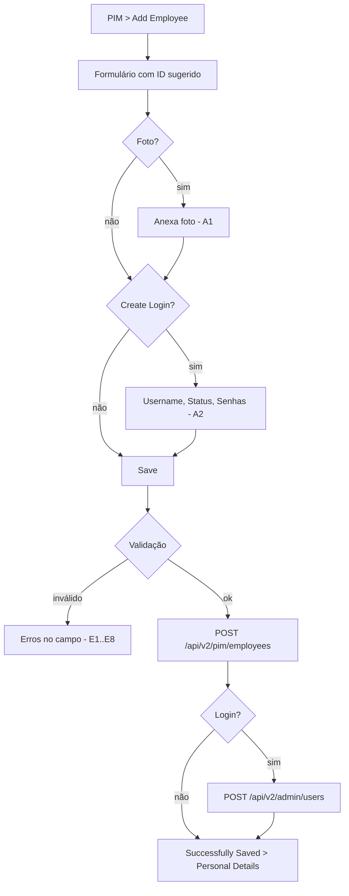

# Jornada de usuário: Admin cadastra um funcionário (PIM › Add Employee)

> Versão analisada: OrangeHRM 5.x, repositório `orangehrm/orangehrm`, commit
> `56e23b3b09e7af29317a0943523b825843fff527` (29/06/2026, "OHRM5X-2669: Update Dockerfile for OrangeHRM 5.9").
> Servidor de demonstração: https://opensource-demo.orangehrmlive.com (Admin / admin123).

## 1. História de usuário

**Como** administrador de RH,
**quero** cadastrar um novo funcionário no módulo PIM, com foto e credenciais de acesso opcionais,
**para que** ele passe a constar no quadro de pessoal e, se for o caso, consiga entrar no sistema.

### Critérios de aceitação (Given / When / Then)

| ID | Critério |
|----|----------|
| CA1 | **Dado** que estou autenticado como Admin, **quando** informo First Name e Last Name válidos e clico em *Save*, **então** o funcionário é criado, vejo o aviso "Successfully Saved" e sou levado à tela *Personal Details* dele. |
| CA2 | **Dado** o formulário aberto, **quando** não altero o campo Employee Id, **então** é usado o próximo ID sugerido pelo sistema (4 dígitos, ex.: `0042`). |
| CA3 | **Dado** que informo um Employee Id já usado por outro funcionário, **quando** saio do campo ou salvo, **então** vejo "Employee Id already exists" e nada é gravado. |
| CA4 | **Dado** que anexo uma foto GIF/JPG/PNG de até 1 MB, **quando** salvo, **então** a foto aparece no perfil do funcionário. |
| CA5 | **Dado** que ativo *Create Login Details* e preencho usuário e senhas válidos, **quando** salvo, **então** é criado também um usuário do sistema (perfil ESS) vinculado ao funcionário, com o status escolhido. |
| CA6 | **Dado** qualquer campo inválido, **quando** tento salvar, **então** a mensagem de erro aparece junto ao campo e nenhum registro é criado. |

## 2. Atores e pré-condições

- **Ator principal:** usuário com papel *Admin* (permissão `EMPLOYEE_ACTION_ADD` no fluxo de funcionário).
- **Pré-condições:** usuário autenticado; acesso ao menu PIM.
- **Pós-condição de sucesso:** registro em `hs_hr_employee` (e `hs_hr_emp_picture` / `ohrm_user`, conforme o fluxo); evento `EmployeeAddedEvent` disparado; contador de ID (`hs_hr_unique_id`) incrementado.

## 3. Campos e regras (confirmados no código)

| Campo | Obrigatório | Regra | Onde está a regra |
|---|---|---|---|
| First Name | Sim | texto, máx. **30** caracteres | `EmployeeService::FIRST_NAME_MAX_LENGTH`; `EmployeeAPI::getCommonBodyValidationRules`; `SaveEmployee.vue` |
| Middle Name | Não | texto, máx. **30** | `EmployeeService::MIDDLE_NAME_MAX_LENGTH` |
| Last Name | Sim | texto, máx. **30** | `EmployeeService::LAST_NAME_MAX_LENGTH` |
| Employee Id | Não (pré-preenchido) | máx. **10**, **único** entre funcionários não expurgados (`purgedAt = null`) | `EmployeeService::EMPLOYEE_ID_MAX_LENGTH`; regra `ENTITY_UNIQUE_PROPERTY` |
| Foto | Não | tipos `gif, jpeg, jpg, jfif, png` (MIME `image/gif`, `image/jpeg`, `image/jpg`, `image/pjpeg`, `image/png`, `image/x-png`); **≤ 1 MB** (só no front-end); nome do arquivo ≤ **100** | `EmpPicture::ALLOWED_IMAGE_*`; `EmployeeAPI::PARAM_RULE_EMP_PICTURE_FILE_NAME_MAX_LENGTH`; `maxFileSize(1024*1024)` em `SaveEmployee.vue` |
| Create Login Details | Não | liga a criação do usuário | `SaveEmployee.vue` |
| Username | Sim, se login | **5 a 40** caracteres, **único** entre usuários não excluídos | `UserService::USERNAME_MIN/MAX_LENGTH`; `UserAPI` |
| Status | Sim, se login | Enabled / Disabled | `UserAPI` (`BOOL_TYPE`) |
| Password | Sim, se login* | máx. **64**; política padrão: mín. **8** caracteres, ≥1 maiúscula, ≥1 minúscula, ≥1 número, ≥1 caractere especial, sem espaços, força mínima *strong* (zxcvbn score ≥ 3). **Na prática o mínimo é 9**: nenhuma senha de 8 caracteres atinge a força exigida (defeito D2) | `Rules\Password`; `PasswordStrengthService::checkPasswordPolicies`; valores padrão em `installer/Migration/V5_4_0/Migration.php` |
| Confirm Password | Sim, se login | igual à senha ("Passwords do not match") | `PasswordInput.vue` |

\* A senha deixa de ser obrigatória quando a autenticação por rede social está ativa (`isPasswordRequired`).

> A política de senha é **configurável** pelo Admin (chaves `auth.password_policy.*` em `ConfigService`). Os testes usam os valores
> padrão; antes de executar no servidor de demonstração, conferir se não foram alterados.

## 4. Fluxo principal (FP)

1. Admin acessa **PIM › Add Employee**.
2. O sistema mostra o formulário com Employee Id pré-preenchido (`IDGeneratorService::getNextID(..., false)`).
3. Admin informa First Name e Last Name (Middle Name é opcional).
4. Admin clica em **Save**.
5. O front-end faz `POST /api/v2/pim/employees`.
6. A API valida, grava o funcionário, incrementa o contador de ID e dispara o evento de criação.
7. O sistema mostra "Successfully Saved" e abre `/pim/viewPersonalDetails/empNumber/{n}`.

## 5. Fluxos alternativos

- **A1 – Com foto:** no passo 3, Admin anexa a foto. No passo 6 a API grava a foto (`EmployeePictureService::saveEmployeePicture`), e o funcionário é salvo em cascata.
- **A2 – Com login:** no passo 3, Admin ativa *Create Login Details* e preenche Username, Status, Password e Confirm Password. Após o passo 6, o front-end faz uma **segunda** requisição, `POST /api/v2/admin/users`, com `userRoleId = 2` (ESS).
- **A3 – ID manual:** no passo 3, Admin substitui o ID sugerido por outro, único e com até 10 caracteres.

## 6. Exceções

| ID | Situação | Resultado esperado |
|---|---|---|
| E1 | First Name ou Last Name vazio | "Required" no campo; sem requisição |
| E2 | Employee Id já existente | "Employee Id already exists"; sem gravação |
| E3 | Foto com tipo inválido ou > 1 MB | "File type not allowed" / "Attachment Size Exceeded"; sem gravação |
| E4 | Username já existente | "Username already exists" |
| E5 | Confirm Password diferente de Password | "Passwords do not match" |
| E6 | Senha fora da política | mensagem de política (ex.: "Should have at least 8 characters", "Your password must contain minimum 1 upper-case letter", "Your password should not contain spaces", "Your password meets the minimum requirements, but it could be guessable") |
| E7 | Campo acima do tamanho máximo (30/30/30/10/40/64) | "Should not exceed N characters" |
| E8 | Username com menos de 5 caracteres | "Should be at least 5 characters" (versões antigas: "Should be least …"; confirmar no servidor) |
| E9 | Usuário sem permissão chama a API | HTTP 400 "Logged in User Not Allowed to Create an Employee" |

## 7. Pontos de risco observados na leitura do código

Estas observações orientam os casos de teste e serão confirmadas (ou descartadas) na execução.

- **R1 – Criação não atômica (A2).** O funcionário e o usuário são criados em duas requisições separadas
  (`SaveEmployee.vue`, método `onSave`). Se a segunda falhar no servidor (ex.: username tomado entre a
  validação e o envio, ou senha recusada pela política do back-end), o funcionário **fica criado sem login**
  e o formulário não mostra o erro de forma clara. *Comportamento confirmado pela API em 12/11/2026 (IT-11):* com
  a 2ª requisição recusada, o funcionário permanece sem nenhum usuário. Na interface o caso é difícil de provocar,
  porque as mesmas regras são validadas antes do envio; fica registrado como risco de projeto, não como defeito.
- **R2 – Contador de ID não incrementado no fluxo com foto (A1).** Em `EmployeeAPI::create()`, só o ramo
  *sem* foto chama `EmployeeService::saveNewEmployee()`, que é quem chama `IDGeneratorService::incrementId()`.
  O ramo com foto chama apenas `EmployeePictureService::saveEmployeePicture()`. Depois de cadastrar alguém com
  foto, o próximo formulário sugere de novo o **mesmo** Employee Id, o que provoca E2 para quem não alterar o
  campo. **Confirmado em 12/11/2026: defeito D1** (ver [defeitos.md](defeitos.md)).
- **R3 – Tamanho da foto validado só no cliente.** *Descartado em 12/11/2026.* A leitura inicial viu o limite
  de 1 MB só no Vue, mas a regra `Base64Attachment` da API também confere o tamanho
  (`ConfigService::MAX_ATTACHMENT_SIZE` = 1.048.576 bytes) e, por padrão (`checkSizeStrictly`), compara o tamanho
  declarado com o conteúdo real. Testado no limite pelo IT-07 (1.048.576 aceito; 1.048.577 e tamanho declarado
  falso recusados).
- **R4 – Unicidade só entre registros não expurgados.** Um ID de funcionário expurgado (*purged*) pode ser
  reutilizado, o que é intencional, mas merece um caso de teste.

## 8. Diagrama do fluxo

## Fontes

- Código-fonte OrangeHRM: https://github.com/orangehrm/orangehrm (commit indicado acima). Arquivos:
  `src/plugins/orangehrmPimPlugin/Api/EmployeeAPI.php`, `Service/EmployeeService.php`, `entity/EmpPicture.php`,
  `Controller/SaveEmployeeController.php`; `src/plugins/orangehrmAdminPlugin/Api/UserAPI.php`,
  `Service/UserService.php`; `src/plugins/orangehrmCorePlugin/Service/IDGeneratorService.php`,
  `Api/V2/Validator/Rules/Password.php`; `src/plugins/orangehrmAuthenticationPlugin/Service/PasswordStrengthService.php`;
  `installer/Migration/V5_4_0/Migration.php`; `src/client/src/orangehrmPimPlugin/pages/employee/SaveEmployee.vue`;
  `src/client/src/core/components/inputs/PasswordInput.vue`.
- Uso de IA: levantamento das regras no código e redação inicial feitos com Claude Code (Claude Opus 5.5),
  revisados pelo autor. Detalhes no diário do trabalho.
