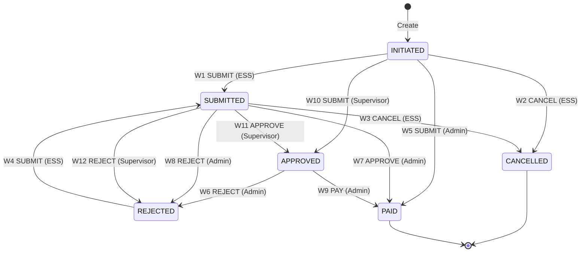

# Plano de testes: Claim (reivindicação de despesa)

> Issue: #6. Base: análise dos testes existentes
> ([`../analise/claim-testes-existentes.md`](../analise/claim-testes-existentes.md), #5).
> Código analisado: `orangehrm/orangehrm`, branch `main`, commit `56e23b3b09e7af29317a0943523b825843fff527`.
> Comportamento conferido no servidor de demonstração (https://opensource-demo.orangehrmlive.com) em 16/11/2026.

## 1. Jornada de usuário

### 1.1 Histórias de usuário

- **HU1 (funcionário):** como funcionário, quero registrar uma reivindicação com as despesas que paguei e
  submetê-la, para ser reembolsado.
- **HU2 (gestor):** como supervisor ou administrador, quero aprovar, rejeitar ou pagar as reivindicações
  submetidas pelos funcionários, para controlar os reembolsos da empresa.

### 1.2 Atores

| Ator | Papel no OrangeHRM | O que faz na jornada |
|---|---|---|
| Funcionário | ESS | Cria a própria reivindicação, adiciona despesas, submete, cancela e ressubmete após rejeição. |
| Supervisor | ESS com subordinados (*Report-to*) | Aprova ou rejeita a reivindicação de um subordinado; pode atribuir uma reivindicação a ele. |
| Administrador | Admin | Aprova, rejeita e paga; pode atribuir uma reivindicação a qualquer funcionário. |

### 1.3 Pré-condições

- PC1: o funcionário tem usuário ativo no papel ESS.
- PC2: há pelo menos um evento (*Claim › Configuration › Events*) e um tipo de despesa (*Expense Types*) ativos.
- PC3: para o fluxo do supervisor, o funcionário está ligado a ele em *PIM › Report-to*.
- PC4: o funcionário não está desligado (*terminated*).

### 1.4 Fluxo principal (FP)

| Passo | Ator | Ação | Resultado |
|---|---|---|---|
| FP1 | Funcionário | *Claim › Submit Claim*: escolhe **Event** e **Currency**, preenche **Remarks** (opcional) e clica em **Create**. | Reivindicação criada no estado **INITIATED**, com número de referência `AAAAMMDD` + id com 7 dígitos (ex.: `202611170000007`). |
| FP2 | Funcionário | Em **Expenses**, clica em **Add** e informa **Expense Type**, **Date**, **Amount** e **Note** (opcional). | Despesa listada; o total da reivindicação é atualizado. |
| FP3 | Funcionário | (Opcional) anexa um comprovante em **Attachments**. | Anexo listado. |
| FP4 | Funcionário | Clica em **Submit**. | Estado **SUBMITTED**; a data de submissão é gravada. |
| FP5 | Supervisor | *Claim › Employee Claims*, abre a reivindicação e clica em **Approve**. | Estado **APPROVED**. |
| FP6 | Administrador | Abre a mesma reivindicação e clica em **Pay**. | Estado **PAID** (estado final). |

**Pós-condição:** a reivindicação aparece como *Paid* em *My Claims* (funcionário) e em *Employee Claims* (gestor).

### 1.5 Fluxos alternativos

| ID | Situação | Desvio a partir de | Resultado |
|---|---|---|---|
| A1 | Funcionário desiste antes de submeter | FP1–FP3: **Cancel** | **CANCELLED** (final) |
| A2 | Funcionário desiste depois de submeter | FP4: **Cancel** | **CANCELLED** (final) |
| A3 | Gestor rejeita; funcionário corrige e ressubmete | FP5: **Reject** (supervisor ou admin) → funcionário edita as despesas → **Submit** | **REJECTED** → **SUBMITTED** |
| A4 | Administrador aprova sem supervisor | FP5 feito pelo admin: **Approve** | **PAID** direto, sem passar por APPROVED |
| A5 | Administrador rejeita uma reivindicação já aprovada pelo supervisor | FP6: **Reject** | **REJECTED** |
| A6 | Administrador cria a reivindicação em nome do funcionário | *Claim › Assign Claim* → despesas → **Submit** | **PAID** direto |
| A7 | Supervisor cria a reivindicação em nome do subordinado | *Assign Claim* → despesas → **Submit** | **APPROVED** direto |
| A8 | Reivindicação atribuída pelo admin, mas submetida pelo próprio funcionário | A6 sem Submit → funcionário abre em *My Claims* → **Submit** | **SUBMITTED** (segue o FP) |

### 1.6 Fluxos de exceção

| ID | Situação | Resultado esperado |
|---|---|---|
| E1 | Event ou Currency não informados | "Required" no campo; nada criado. |
| E2 | Remarks com mais de 1000 caracteres | Erro de validação; nada criado. |
| E3 | Evento inativo ou inexistente; moeda inexistente | Erro de validação (422). |
| E4 | Amount inválido: 0, negativo, acima de 9 999 999 999,99 ou com mais de 2 casas decimais | Erro de validação; despesa não gravada. |
| E5 | Note da despesa com mais de 1000 caracteres | Erro de validação. |
| E6 | Ação não permitida ao papel no estado atual (ex.: funcionário aprova a própria; supervisor paga; qualquer ação em CANCELLED ou PAID) | Botão ausente na tela; pela API, **403** e o estado não muda. |
| E7 | Incluir, alterar ou excluir despesa depois de submetida | Não permitido (403); a despesa só muda em INITIATED ou REJECTED. |
| E8 | Reivindicação para funcionário desligado | Proibido (403). |

### 1.7 Critérios de aceitação

```gherkin
CA1 – Submissão
  Dado um funcionário com uma reivindicação INITIATED com ao menos uma despesa
  Quando ele clica em Submit
  Então o estado passa a SUBMITTED
  E a data de submissão é a data do servidor

CA2 – Aprovação pelo supervisor
  Dada uma reivindicação SUBMITTED de um subordinado
  Quando o supervisor clica em Approve
  Então o estado passa a APPROVED
  E o supervisor não vê mais nenhuma ação disponível

CA3 – Pagamento
  Dada uma reivindicação APPROVED
  Quando o administrador clica em Pay
  Então o estado passa a PAID
  E nenhum papel vê ações disponíveis

CA4 – Rejeição e ressubmissão
  Dada uma reivindicação SUBMITTED
  Quando o supervisor ou o administrador clica em Reject
  Então o estado passa a REJECTED
  E o funcionário vê apenas a ação Submit
  E, ao submeter de novo, o estado volta a SUBMITTED

CA5 – Cancelamento
  Dada uma reivindicação INITIATED ou SUBMITTED do próprio funcionário
  Quando ele clica em Cancel
  Então o estado passa a CANCELLED
  E nenhuma outra ação é aceita depois disso

CA6 – Ações restritas por papel
  Dada uma reivindicação em qualquer estado
  Quando um usuário tenta uma ação que o seu papel não tem nesse estado
  Então a ação é recusada (403)
  E o estado e a data de submissão não mudam

CA7 – Valor da despesa
  Dada uma reivindicação INITIATED
  Quando o funcionário informa um valor entre 0,01 e 9 999 999 999,99, com até 2 casas decimais
  Então a despesa é gravada
  Mas, com 0, valor negativo, valor acima do máximo ou 3 casas decimais, a despesa é recusada

CA8 – Atribuição pelo gestor
  Dado um administrador (ou supervisor) que cria uma reivindicação em nome de um funcionário
  Quando ele mesmo a submete
  Então o estado passa a PAID (admin) ou APPROVED (supervisor)
```

> CA2, CA3, CA4 e CA8 descrevem o comportamento **observado no servidor** e cadastrado na migração
> `installer/Migration/V5_5_0/Migration.php`. Nenhum documento do OrangeHRM especifica essas regras; a
> conferência está na seção 2.

## 2. Máquina de estados

### 2.1 Como foi conferida

As transições cadastradas na migração (`installer/Migration/V5_5_0/Migration.php`, linhas 322–407; ver #5) foram
executadas no servidor de demonstração pela API REST, a mesma que as telas usam, com o roteiro
[`evidencias/verifica-claim.mjs`](evidencias/verifica-claim.mjs):

1. Como Admin, cria dois funcionários com sufixo único (`VVEss <sufixo>` e `VVSup <sufixo>`), um usuário ESS para
   cada um e o vínculo *Report-to* (VVSup supervisiona VVEss). Nenhum dado de outros usuários do servidor é usado.
2. Para cada cenário, cria uma reivindicação nova com uma despesa de 10,50 USD.
3. Antes de cada ação, registra as ações que o papel recebe em `meta.allowedActions` (é essa lista que decide quais
   botões a tela mostra); depois, executa `PUT /api/v2/claim/requests/{id}/action` e lê de novo o estado e o
   `submittedDate` pela listagem do Admin.

O roteiro foi executado duas vezes em 16/11/2026. O servidor foi reiniciado entre as execuções (os ids recomeçaram),
e os resultados das 12 transições foram iguais nas duas. O registro completo da segunda está em
[`evidencias/verificacao-2026-11-16.json`](evidencias/verificacao-2026-11-16.json) (reivindicações
`202611170000007` a `202611170000016`).

### 2.2 Estados

| Estado | Significado | Final? |
|---|---|---|
| INITIATED | Criada, ainda em edição (despesas e anexos podem mudar) | Não |
| SUBMITTED | Enviada para avaliação | Não |
| APPROVED | Aprovada pelo supervisor, aguardando pagamento | Não |
| REJECTED | Rejeitada; o funcionário pode corrigir e ressubmeter | Não |
| CANCELLED | Cancelada pelo funcionário | **Sim** |
| PAID | Paga | **Sim** |

### 2.3 Diagrama



### 2.4 Transições válidas

| # | Estado | Papel | Ação | Esperado (migração) | Observado no servidor | Evidência |
|---|---|---|---|---|---|---|
| W1 | INITIATED | ESS | SUBMIT | SUBMITTED | SUBMITTED, `submittedDate` gravado | `…0000007` |
| W2 | INITIATED | ESS | CANCEL | CANCELLED | CANCELLED, `submittedDate` vazio | `…0000008` |
| W3 | SUBMITTED | ESS | CANCEL | CANCELLED | CANCELLED | `…0000007` |
| W4 | REJECTED | ESS | SUBMIT | SUBMITTED | SUBMITTED | `…0000010` |
| W5 | INITIATED | Admin | SUBMIT | PAID | **PAID** | `…0000014` |
| W6 | APPROVED | Admin | REJECT | REJECTED | REJECTED | `…0000012` |
| W7 | SUBMITTED | Admin | APPROVE | PAID | **PAID** (não passa por APPROVED) | `…0000009` |
| W8 | SUBMITTED | Admin | REJECT | REJECTED | REJECTED | `…0000010` |
| W9 | APPROVED | Admin | PAY | PAID | PAID | `…0000011` |
| W10 | INITIATED | Supervisor | SUBMIT | APPROVED | APPROVED | `…0000015` |
| W11 | SUBMITTED | Supervisor | APPROVE | APPROVED | APPROVED | `…0000011`, `…0000012` |
| W12 | SUBMITTED | Supervisor | REJECT | REJECTED | REJECTED | `…0000013` |

Todas responderam HTTP 200. Também foi observado que a reivindicação criada pelo Admin em nome do funcionário e
deixada em INITIATED pode ser submetida pelo **próprio funcionário** (W1, `…0000016`), indo para SUBMITTED (fluxo A8).

### 2.5 Ações disponíveis por papel e estado

Valores de `meta.allowedActions` lidos no servidor. "–" significa lista vazia (nenhum botão de ação); "n. o." significa
combinação não observada, com a expectativa derivada da migração entre parênteses.

| Estado | ESS (dono) | Supervisor | Admin |
|---|---|---|---|
| INITIATED (criada pelo ESS) | SUBMIT, CANCEL | n. o. (–) | n. o. (–) |
| INITIATED (atribuída pelo gestor) | SUBMIT, CANCEL | SUBMIT | SUBMIT |
| SUBMITTED | CANCEL | APPROVE, REJECT | APPROVE, REJECT |
| APPROVED | – | – | REJECT, PAY |
| REJECTED | SUBMIT | n. o. (–) | n. o. (–) |
| CANCELLED | – | n. o. (–) | n. o. (–) |
| PAID | n. o. (–) | n. o. (–) | – |

> As linhas "INITIATED" não contradizem a migração: o gestor só vê SUBMIT quando foi ele quem criou a reivindicação
> pela tela *Assign Claim*; para a reivindicação criada pelo próprio funcionário, o servidor não foi consultado e a
> expectativa vem do código. Esses "n. o." serão verificados nos casos de transição proibida (seção 3).

### 2.6 Transições proibidas observadas

| Estado | Papel | Ação | Resposta | Estado depois | Evidência |
|---|---|---|---|---|---|
| SUBMITTED | ESS (dono) | APPROVE | 403 "Unauthorized" | SUBMITTED | `…0000007` |
| CANCELLED | ESS | SUBMIT | 403 | CANCELLED | `…0000008` |
| PAID | Admin | CANCEL | 403 | PAID | `…0000009` |
| APPROVED | Supervisor | PAY | 403 | APPROVED | `…0000011` |
| APPROVED | ESS | CANCEL | 403 | APPROVED | `…0000011` |
| REJECTED | ESS | CANCEL | 403 | REJECTED | `…0000013` |

### 2.7 Riscos levantados

| ID | Risco | Origem | Como será testado |
|---|---|---|---|
| R1 | **Admin aprova = pago** (W7) e **reivindicação atribuída pelo Admin nasce paga** (W5). Não há etapa de pagamento separada, e nenhum documento especifica essa regra. | Migração + servidor | Casos de transição W5 e W7, com o oráculo citando esta seção (comportamento caracterizado, não requisito). |
| R2 | **Editar uma despesa aceita valor 0.** Na criação, o valor tem `Rules::POSITIVE` + `BETWEEN [0, 9999999999.99]`; na edição (`ClaimExpenseAPI::getValidationRuleForUpdate`), só `BETWEEN`. | Código | Valor-limite 0 e 0,01 em criação **e** edição. |
| R3 | **Submeter sem despesas.** `ClaimRequestActionAPI::update()` não verifica se há despesa; a exigência, se existir, está só na tela. | Código | Submissão de reivindicação vazia pela API e pela tela. |
| R4 | **Número de referência com mais de 7 dígitos de id.** `ClaimService::getReferenceId()` usa `str_pad(…, 7, '0')`; a partir do id 10 000 000, o número passa a ter 16 caracteres. | Código (#5) | Teste unitário com ids 9 999 999 e 10 000 000. |
| R5 | **Data em UTC.** Às 23h de 16/11 (horário de Brasília), o servidor gerou `20261117…` e `submittedDate` 2026-11-17. Um teste que compare com a data local falha entre 21h e 0h. | Servidor | Oráculo de data calculado em UTC (ou data fixada no teste unitário). |
| R6 | **Supervisor não rejeita depois de aprovar.** Em APPROVED, o supervisor não tem ação; só o Admin pode rejeitar (W6). | Servidor | Transição proibida "Supervisor REJECT em APPROVED". |

## Uso de IA

Redação inicial feita com Claude Code (Claude Opus 5.5, Anthropic), a partir do código do OrangeHRM e da
conferência no servidor; revisão e ajustes feitos pelo autor.
