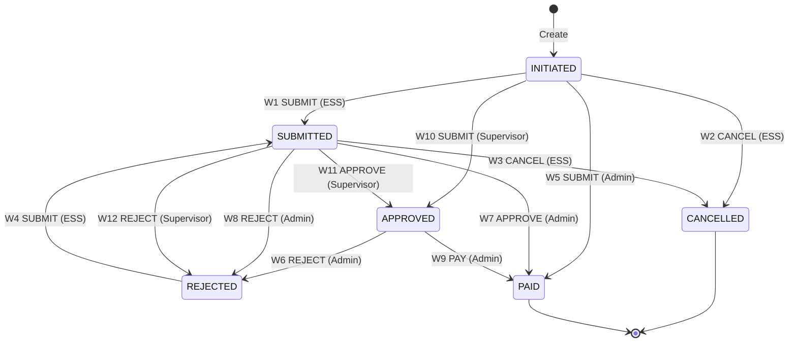

# Plano de testes: Claim (reivindicação de despesa)

> Issue: #6. Base: análise dos testes existentes
> ([`../analise/claim-testes-existentes.md`](../analise/claim-testes-existentes.md), #5).
> Código analisado: `orangehrm/orangehrm`, branch `main`, commit `56e23b3b09e7af29317a0943523b825843fff527`.
> Comportamento conferido no servidor de demonstração (https://opensource-demo.orangehrmlive.com) em 16/11/2026.

## 1. Jornada de usuário

### 1.1 Histórias de usuário

- **HU1 (funcionário):** como funcionário, quero registrar uma reivindicação com as despesas que paguei e
  submetê-la, para ser reembolsado.
- **HU2 (gestor):** como supervisor ou administrador, quero aprovar, rejeitar ou pagar as reivindicações
  submetidas pelos funcionários, para controlar os reembolsos da empresa.

### 1.2 Atores

| Ator | Papel no OrangeHRM | O que faz na jornada |
|---|---|---|
| Funcionário | ESS | Cria a própria reivindicação, adiciona despesas, submete, cancela e ressubmete após rejeição. |
| Supervisor | ESS com subordinados (*Report-to*) | Aprova ou rejeita a reivindicação de um subordinado; pode atribuir uma reivindicação a ele. |
| Administrador | Admin | Aprova, rejeita e paga; pode atribuir uma reivindicação a qualquer funcionário. |

### 1.3 Pré-condições

- PC1: o funcionário tem usuário ativo no papel ESS.
- PC2: há pelo menos um evento (*Claim › Configuration › Events*) e um tipo de despesa (*Expense Types*) ativos.
- PC3: para o fluxo do supervisor, o funcionário está ligado a ele em *PIM › Report-to*.
- PC4: o funcionário não está desligado (*terminated*).

### 1.4 Fluxo principal (FP)

| Passo | Ator | Ação | Resultado |
|---|---|---|---|
| FP1 | Funcionário | *Claim › Submit Claim*: escolhe **Event** e **Currency**, preenche **Remarks** (opcional) e clica em **Create**. | Reivindicação criada no estado **INITIATED**, com número de referência `AAAAMMDD` + id com 7 dígitos (ex.: `202611170000007`). |
| FP2 | Funcionário | Em **Expenses**, clica em **Add** e informa **Expense Type**, **Date**, **Amount** e **Note** (opcional). | Despesa listada; o total da reivindicação é atualizado. |
| FP3 | Funcionário | (Opcional) anexa um comprovante em **Attachments**. | Anexo listado. |
| FP4 | Funcionário | Clica em **Submit**. | Estado **SUBMITTED**; a data de submissão é gravada. |
| FP5 | Supervisor | *Claim › Employee Claims*, abre a reivindicação e clica em **Approve**. | Estado **APPROVED**. |
| FP6 | Administrador | Abre a mesma reivindicação e clica em **Pay**. | Estado **PAID** (estado final). |

**Pós-condição:** a reivindicação aparece como *Paid* em *My Claims* (funcionário) e em *Employee Claims* (gestor).

### 1.5 Fluxos alternativos

| ID | Situação | Desvio a partir de | Resultado |
|---|---|---|---|
| A1 | Funcionário desiste antes de submeter | FP1–FP3: **Cancel** | **CANCELLED** (final) |
| A2 | Funcionário desiste depois de submeter | FP4: **Cancel** | **CANCELLED** (final) |
| A3 | Gestor rejeita; funcionário corrige e ressubmete | FP5: **Reject** (supervisor ou admin) → funcionário edita as despesas → **Submit** | **REJECTED** → **SUBMITTED** |
| A4 | Administrador aprova sem supervisor | FP5 feito pelo admin: **Approve** | **PAID** direto, sem passar por APPROVED |
| A5 | Administrador rejeita uma reivindicação já aprovada pelo supervisor | FP6: **Reject** | **REJECTED** |
| A6 | Administrador cria a reivindicação em nome do funcionário | *Claim › Assign Claim* → despesas → **Submit** | **PAID** direto |
| A7 | Supervisor cria a reivindicação em nome do subordinado | *Assign Claim* → despesas → **Submit** | **APPROVED** direto |
| A8 | Reivindicação atribuída pelo admin, mas submetida pelo próprio funcionário | A6 sem Submit → funcionário abre em *My Claims* → **Submit** | **SUBMITTED** (segue o FP) |

### 1.6 Fluxos de exceção

| ID | Situação | Resultado esperado |
|---|---|---|
| E1 | Event ou Currency não informados | "Required" no campo; nada criado. |
| E2 | Remarks com mais de 1000 caracteres | Erro de validação; nada criado. |
| E3 | Evento inativo ou inexistente; moeda inexistente | Erro de validação (422). |
| E4 | Amount inválido: 0, negativo, acima de 9 999 999 999,99 ou com mais de 2 casas decimais | Erro de validação; despesa não gravada. |
| E5 | Note da despesa com mais de 1000 caracteres | Erro de validação. |
| E6 | Ação não permitida ao papel no estado atual (ex.: funcionário aprova a própria; supervisor paga; qualquer ação em CANCELLED ou PAID) | Botão ausente na tela; pela API, **403** e o estado não muda. |
| E7 | Incluir, alterar ou excluir despesa depois de submetida | Não permitido (403); a despesa só muda em INITIATED ou REJECTED. |
| E8 | Reivindicação para funcionário desligado | Proibido (403). |

### 1.7 Critérios de aceitação

```gherkin
CA1 – Submissão
  Dado um funcionário com uma reivindicação INITIATED com ao menos uma despesa
  Quando ele clica em Submit
  Então o estado passa a SUBMITTED
  E a data de submissão é a data do servidor

CA2 – Aprovação pelo supervisor
  Dada uma reivindicação SUBMITTED de um subordinado
  Quando o supervisor clica em Approve
  Então o estado passa a APPROVED
  E o supervisor não vê mais nenhuma ação disponível

CA3 – Pagamento
  Dada uma reivindicação APPROVED
  Quando o administrador clica em Pay
  Então o estado passa a PAID
  E nenhum papel vê ações disponíveis

CA4 – Rejeição e ressubmissão
  Dada uma reivindicação SUBMITTED
  Quando o supervisor ou o administrador clica em Reject
  Então o estado passa a REJECTED
  E o funcionário vê apenas a ação Submit
  E, ao submeter de novo, o estado volta a SUBMITTED

CA5 – Cancelamento
  Dada uma reivindicação INITIATED ou SUBMITTED do próprio funcionário
  Quando ele clica em Cancel
  Então o estado passa a CANCELLED
  E nenhuma outra ação é aceita depois disso

CA6 – Ações restritas por papel
  Dada uma reivindicação em qualquer estado
  Quando um usuário tenta uma ação que o seu papel não tem nesse estado
  Então a ação é recusada (403)
  E o estado e a data de submissão não mudam

CA7 – Valor da despesa
  Dada uma reivindicação INITIATED
  Quando o funcionário informa um valor entre 0,01 e 9 999 999 999,99, com até 2 casas decimais
  Então a despesa é gravada
  Mas, com 0, valor negativo, valor acima do máximo ou 3 casas decimais, a despesa é recusada

CA8 – Atribuição pelo gestor
  Dado um administrador (ou supervisor) que cria uma reivindicação em nome de um funcionário
  Quando ele mesmo a submete
  Então o estado passa a PAID (admin) ou APPROVED (supervisor)
```

> CA2, CA3, CA4 e CA8 descrevem o comportamento **observado no servidor** e cadastrado na migração
> `installer/Migration/V5_5_0/Migration.php`. Nenhum documento do OrangeHRM especifica essas regras; a
> conferência está na seção 2.

## 2. Máquina de estados

### 2.1 Como foi conferida

As transições cadastradas na migração (`installer/Migration/V5_5_0/Migration.php`, linhas 322–407; ver #5) foram
executadas no servidor de demonstração pela API REST, a mesma que as telas usam, com o roteiro
[`evidencias/verifica-claim.mjs`](evidencias/verifica-claim.mjs):

1. Como Admin, cria dois funcionários com sufixo único (`VVEss <sufixo>` e `VVSup <sufixo>`), um usuário ESS para
   cada um e o vínculo *Report-to* (VVSup supervisiona VVEss). Nenhum dado de outros usuários do servidor é usado.
2. Para cada cenário, cria uma reivindicação nova com uma despesa de 10,50 USD.
3. Antes de cada ação, registra as ações que o papel recebe em `meta.allowedActions` (é essa lista que decide quais
   botões a tela mostra); depois, executa `PUT /api/v2/claim/requests/{id}/action` e lê de novo o estado e o
   `submittedDate` pela listagem do Admin.

O roteiro foi executado duas vezes em 16/11/2026. O servidor foi reiniciado entre as execuções (os ids recomeçaram),
e os resultados das 12 transições foram iguais nas duas. O registro completo da segunda está em
[`evidencias/verificacao-2026-11-16.json`](evidencias/verificacao-2026-11-16.json) (reivindicações
`202611170000007` a `202611170000016`).

### 2.2 Estados

| Estado | Significado | Final? |
|---|---|---|
| INITIATED | Criada, ainda em edição (despesas e anexos podem mudar) | Não |
| SUBMITTED | Enviada para avaliação | Não |
| APPROVED | Aprovada pelo supervisor, aguardando pagamento | Não |
| REJECTED | Rejeitada; o funcionário pode corrigir e ressubmeter | Não |
| CANCELLED | Cancelada pelo funcionário | **Sim** |
| PAID | Paga | **Sim** |

### 2.3 Diagrama



### 2.4 Transições válidas

| # | Estado | Papel | Ação | Esperado (migração) | Observado no servidor | Evidência |
|---|---|---|---|---|---|---|
| W1 | INITIATED | ESS | SUBMIT | SUBMITTED | SUBMITTED, `submittedDate` gravado | `…0000007` |
| W2 | INITIATED | ESS | CANCEL | CANCELLED | CANCELLED, `submittedDate` vazio | `…0000008` |
| W3 | SUBMITTED | ESS | CANCEL | CANCELLED | CANCELLED | `…0000007` |
| W4 | REJECTED | ESS | SUBMIT | SUBMITTED | SUBMITTED | `…0000010` |
| W5 | INITIATED | Admin | SUBMIT | PAID | **PAID** | `…0000014` |
| W6 | APPROVED | Admin | REJECT | REJECTED | REJECTED | `…0000012` |
| W7 | SUBMITTED | Admin | APPROVE | PAID | **PAID** (não passa por APPROVED) | `…0000009` |
| W8 | SUBMITTED | Admin | REJECT | REJECTED | REJECTED | `…0000010` |
| W9 | APPROVED | Admin | PAY | PAID | PAID | `…0000011` |
| W10 | INITIATED | Supervisor | SUBMIT | APPROVED | APPROVED | `…0000015` |
| W11 | SUBMITTED | Supervisor | APPROVE | APPROVED | APPROVED | `…0000011`, `…0000012` |
| W12 | SUBMITTED | Supervisor | REJECT | REJECTED | REJECTED | `…0000013` |

Todas responderam HTTP 200. Também foi observado que a reivindicação criada pelo Admin em nome do funcionário e
deixada em INITIATED pode ser submetida pelo **próprio funcionário** (W1, `…0000016`), indo para SUBMITTED (fluxo A8).

### 2.5 Ações disponíveis por papel e estado

Valores de `meta.allowedActions` lidos no servidor. "–" significa lista vazia (nenhum botão de ação); "n. o." significa
combinação não observada, com a expectativa derivada da migração entre parênteses.

| Estado | ESS (dono) | Supervisor | Admin |
|---|---|---|---|
| INITIATED (criada pelo ESS) | SUBMIT, CANCEL | n. o. (SUBMIT) | n. o. (SUBMIT) |
| INITIATED (atribuída pelo gestor) | SUBMIT, CANCEL | SUBMIT | SUBMIT |
| SUBMITTED | CANCEL | APPROVE, REJECT | APPROVE, REJECT |
| APPROVED | – | – | REJECT, PAY |
| REJECTED | SUBMIT | n. o. (–) | n. o. (–) |
| CANCELLED | – | n. o. (–) | n. o. (–) |
| PAID | n. o. (–) | n. o. (–) | – |

> A migração dá SUBMIT ao Admin e ao supervisor em **qualquer** reivindicação INITIATED, e não só nas criadas por
> eles em *Assign Claim*. O caso original "Admin SUBMIT ESS INITIATED" (#5) confirma isso para o Admin: a
> reivindicação que o funcionário ainda está editando vai para PAID (risco R7). As combinações "n. o." serão
> verificadas pelos casos da seção 3.

### 2.6 Transições proibidas observadas

| Estado | Papel | Ação | Resposta | Estado depois | Evidência |
|---|---|---|---|---|---|
| SUBMITTED | ESS (dono) | APPROVE | 403 "Unauthorized" | SUBMITTED | `…0000007` |
| CANCELLED | ESS | SUBMIT | 403 | CANCELLED | `…0000008` |
| PAID | Admin | CANCEL | 403 | PAID | `…0000009` |
| APPROVED | Supervisor | PAY | 403 | APPROVED | `…0000011` |
| APPROVED | ESS | CANCEL | 403 | APPROVED | `…0000011` |
| REJECTED | ESS | CANCEL | 403 | REJECTED | `…0000013` |

### 2.7 Riscos levantados

| ID | Risco | Origem | Como será testado |
|---|---|---|---|
| R1 | **Admin aprova = pago** (W7) e **reivindicação atribuída pelo Admin nasce paga** (W5). Não há etapa de pagamento separada, e nenhum documento especifica essa regra. | Migração + servidor | Casos de transição W5 e W7, com o oráculo citando esta seção (comportamento caracterizado, não requisito). |
| R2 | **Editar uma despesa aceita valor 0.** Na criação, o valor tem `Rules::POSITIVE` + `BETWEEN [0, 9999999999.99]`; na edição (`ClaimExpenseAPI::getValidationRuleForUpdate`), só `BETWEEN`. | Código | Valor-limite 0 e 0,01 em criação **e** edição. |
| R3 | **Submeter sem despesas.** `ClaimRequestActionAPI::update()` não verifica se há despesa; a exigência, se existir, está só na tela. | Código | Submissão de reivindicação vazia pela API e pela tela. |
| R4 | **Número de referência com mais de 7 dígitos de id.** `ClaimService::getReferenceId()` usa `str_pad(…, 7, '0')`; a partir do id 10 000 000, o número passa a ter 16 caracteres. | Código (#5) | Teste unitário com ids 9 999 999 e 10 000 000. |
| R5 | **Data em UTC.** Às 23h de 16/11 (horário de Brasília), o servidor gerou `20261117…` e `submittedDate` 2026-11-17. Um teste que compare com a data local falha entre 21h e 0h. | Servidor | Oráculo de data calculado em UTC (ou data fixada no teste unitário). |
| R6 | **Supervisor não rejeita depois de aprovar.** Em APPROVED, o supervisor não tem ação; só o Admin pode rejeitar (W6). | Servidor | Transição proibida "Supervisor REJECT em APPROVED". |
| R7 | **Gestor submete o rascunho do funcionário.** Admin e supervisor têm SUBMIT em INITIATED mesmo quando a reivindicação foi criada pelo funcionário, que ainda pode estar adicionando despesas; com o Admin, ela vai direto para PAID. | Migração + teste original (#5) | Caminhos TT-08b e TT-09b da árvore de transição (seção 3). |
| R8 | **Estado resultante ambíguo para quem tem dois papéis.** `ClaimRequestActionAPI::getResultingState()` consulta as transições sem excluir papéis e devolve a **primeira** que casa com a ação. Quando o Admin submete a **própria** reivindicação, casam a linha ESS (→ SUBMITTED) e a linha ADMIN (→ PAID); o resultado depende da ordem das linhas em `ohrm_workflow_state_machine`. | Código | Caminho TT-10 (seção 3). |

## 3. Casos derivados da máquina de estados

### 3.1 Árvore de transição

A árvore parte do estado inicial (INITIATED) e expande cada transição da seção 2.4. Um nó vira folha quando o estado
é final (CANCELLED, PAID) ou quando já apareceu antes no mesmo caminho ou em outro ramo já expandido (marcado com ↺).
Cada caminho da raiz até uma folha é um caso de teste.

```text
INITIATED
├── W2  ESS CANCEL ───────────────▶ CANCELLED                       TT-01
├── W1  ESS SUBMIT ───────────────▶ SUBMITTED
│   ├── W3  ESS CANCEL ───────────▶ CANCELLED                       TT-02
│   ├── W7  Admin APPROVE ────────▶ PAID                            TT-03
│   ├── W8  Admin REJECT ─────────▶ REJECTED
│   │   └── W4  ESS SUBMIT ───────▶ SUBMITTED ↺                     TT-04
│   ├── W11 Supervisor APPROVE ───▶ APPROVED
│   │   ├── W6  Admin REJECT ─────▶ REJECTED ↺                      TT-05
│   │   └── W9  Admin PAY ────────▶ PAID                            TT-06
│   └── W12 Supervisor REJECT ────▶ REJECTED ↺                      TT-07
├── W5  Admin SUBMIT ─────────────▶ PAID                            TT-08a / TT-08b
└── W10 Supervisor SUBMIT ────────▶ APPROVED ↺                      TT-09a / TT-09b
```

### 3.2 Caminhos (casos de transição)

Oráculo comum a todos: depois de cada ação, (1) a resposta tem o estado esperado; (2) o estado **lido de novo**
(banco na integração, tela *Employee Claims* no sistema) é o mesmo; (3) as ações disponíveis para cada papel
batem com a seção 2.5.

| ID | Pré-condição | Caminho | Transições | Estados visitados | Verificação extra |
|---|---|---|---|---|---|
| TT-01 | Criada pelo ESS | CANCEL (ESS) | W2 | INITIATED, CANCELLED | `submittedDate` continua vazio |
| TT-02 | Criada pelo ESS | SUBMIT (ESS) → CANCEL (ESS) | W1, W3 | INITIATED, SUBMITTED, CANCELLED | `submittedDate` preservado após o cancelamento |
| TT-03 | Criada pelo ESS | SUBMIT (ESS) → APPROVE (Admin) | W1, W7 | INITIATED, SUBMITTED, PAID | não passa por APPROVED (R1) |
| TT-04 | Criada pelo ESS | SUBMIT (ESS) → REJECT (Admin) → SUBMIT (ESS) | W1, W8, W4 | INITIATED, SUBMITTED, REJECTED | `submittedDate` atualizado na ressubmissão |
| TT-05 | Criada pelo ESS; ESS ligado ao supervisor | SUBMIT (ESS) → APPROVE (Sup.) → REJECT (Admin) | W1, W11, W6 | INITIATED, SUBMITTED, APPROVED, REJECTED | – |
| TT-06 | idem | SUBMIT (ESS) → APPROVE (Sup.) → PAY (Admin) | W1, W11, W9 | INITIATED, SUBMITTED, APPROVED, PAID | **fluxo principal (FP)** |
| TT-07 | idem | SUBMIT (ESS) → REJECT (Sup.) | W1, W12 | INITIATED, SUBMITTED, REJECTED | – |
| TT-08a | Criada pelo Admin (*Assign Claim*) | SUBMIT (Admin) | W5 | INITIATED, PAID | nasce paga (R1) |
| TT-08b | Criada pelo **ESS** | SUBMIT (Admin) | W5 | INITIATED, PAID | gestor submete rascunho alheio (R7) |
| TT-09a | Criada pelo supervisor (*Assign Claim*) | SUBMIT (Sup.) | W10 | INITIATED, APPROVED | – |
| TT-09b | Criada pelo **ESS** | SUBMIT (Sup.) | W10 | INITIATED, APPROVED | gestor submete rascunho alheio (R7) |
| TT-10 | Criada pelo **Admin para si mesmo** (*Submit Claim*) | SUBMIT (Admin, dono) | W1 (esperado) | INITIATED, SUBMITTED | o Admin não pode aprovar o próprio reembolso: esperado SUBMITTED, e não PAID (R8) |

**Cobertura:**

- **Estados:** 6 de 6. O conjunto mínimo é TT-01, TT-04 e TT-06.
- **Transições:** 12 de 12 (100%). Os 9 caminhos TT-01 a TT-09a cobrem todas; TT-08b e TT-09b repetem W5 e W10
  com outra pré-condição, por causa de R7, e TT-10 repete W1 com um usuário de dois papéis, por causa de R8.
- Comparação: os testes originais cobrem 5 de 12 (#5).

### 3.3 Transições proibidas (*sneak paths*)

São 6 estados × 3 papéis × 5 ações = 90 combinações, das quais 12 são válidas. Critério de seleção: **pelo menos
uma ação proibida para cada par (estado, papel)**, que dá 18 pares, priorizando a ação que mais "parece" possível
(ex.: pagar logo depois de aprovar). Somam-se o caso de um usuário sem vínculo e o de uma ação inexistente.

Resultado esperado em todos (salvo SP-21): **HTTP 403**, estado inalterado e `submittedDate` inalterado.

| ID | Estado | Papel | Ação | Motivo da escolha |
|---|---|---|---|---|
| SP-01 | INITIATED | ESS (dono) | APPROVE | funcionário aprovando a própria |
| SP-02 | INITIATED | Supervisor | APPROVE | aprovar sem submissão |
| SP-03 | INITIATED | Admin | PAY | pagar sem submissão |
| SP-04 | SUBMITTED | ESS (dono) | APPROVE | observado no servidor (2.6) |
| SP-05 | SUBMITTED | ESS (dono) | PAY | – |
| SP-06 | SUBMITTED | Supervisor | PAY | supervisor pulando a aprovação |
| SP-07 | SUBMITTED | Admin | PAY | pagar sem aprovar (o Admin só chega a PAID por APPROVE) |
| SP-08 | APPROVED | ESS (dono) | CANCEL | observado no servidor (2.6) |
| SP-09 | APPROVED | Supervisor | PAY | observado no servidor (2.6); nome enganoso no teste original (#5) |
| SP-10 | APPROVED | Supervisor | REJECT | R6 |
| SP-11 | APPROVED | Admin | APPROVE | aprovar duas vezes |
| SP-12 | REJECTED | ESS (dono) | CANCEL | observado no servidor (2.6) |
| SP-13 | REJECTED | Supervisor | APPROVE | rever a própria rejeição |
| SP-14 | REJECTED | Admin | PAY | pagar o que foi rejeitado |
| SP-15 | CANCELLED | ESS (dono) | SUBMIT | observado no servidor (2.6) |
| SP-16 | CANCELLED | Supervisor | APPROVE | – |
| SP-17 | CANCELLED | Admin | APPROVE | – |
| SP-18 | PAID | ESS (dono) | SUBMIT | – |
| SP-19 | PAID | Supervisor | REJECT | – |
| SP-20 | PAID | Admin | CANCEL | observado no servidor (2.6) |
| SP-21 | SUBMITTED | Admin | `FOO` (ação inexistente) | esperado **422** (validação), não 403 |
| SP-22 | SUBMITTED | ESS **sem vínculo** (outro funcionário, não supervisor) | APPROVE | usuário alheio à reivindicação |

Cobertura de *sneak paths*: 18 de 18 pares (estado, papel), 20 das 78 combinações proibidas. Os casos de 2.6, já
observados, são repetidos aqui para que façam parte da suíte automatizada.

## 4. Particionamento em classes de equivalência e valor-limite

### 4.1 Regras de entrada (fonte: código)

| Campo | Onde | Regra no servidor |
|---|---|---|
| Event (`claimEventId`) | `EmployeeClaimRequestAPI::getCommonParamRuleCollection` | obrigatório, inteiro positivo; o evento precisa existir e estar ativo |
| Currency (`currencyId`) | idem | obrigatório; a moeda precisa existir |
| Remarks (`remarks`) | idem | opcional; `LENGTH [null, 1000]` |
| Expense Type (`expenseTypeId`) | `ClaimExpenseAPI::setClaimExpense` | obrigatório, inteiro positivo; o tipo precisa existir e estar ativo |
| Date (`date`) | `ClaimExpenseAPI` | obrigatório; `Rules::API_DATE` (formato `AAAA-MM-DD`); **sem limite de período** |
| Amount (`amount`) | `ClaimExpenseAPI` | criação: `POSITIVE` + `BETWEEN [0, 9999999999.99]`; edição: só `BETWEEN` (R2); nas duas, regex `/^\d+(\.\d{1,2})?$/` |
| Note (`note`) | `ClaimExpenseAPI` | opcional; `LENGTH [null, 1000]` |
| Descrição do anexo | `ClaimAttachmentAPI` | opcional; `LENGTH [null, 200]` |
| Número de referência | `ClaimService::getReferenceId()` | gerado: data `Ymd` do servidor + próximo id com `str_pad(…, 7, '0', STR_PAD_LEFT)` |

### 4.2 Classes de equivalência

| Campo | Classes válidas | Classes inválidas |
|---|---|---|
| Event | V1: evento ativo | I1: ausente; I2: evento inativo; I3: id inexistente; I4: id ≤ 0 |
| Currency | V2: moeda existente (`USD`) | I5: ausente; I6: código inexistente (`XYZ`) |
| Remarks | V3: ausente/nulo; V4: 1–1000 caracteres | I7: > 1000 caracteres |
| Expense Type | V5: tipo ativo | I8: ausente; I9: tipo inativo; I10: id inexistente |
| Date | V6: data válida no formato `AAAA-MM-DD` | I11: ausente; I12: outro formato (`17/11/2026`); I13: data inexistente (`2026-02-30`) |
| Date (sem regra definida) | V7?: data futura; V8?: data anterior à criação da reivindicação | – (o código aceita; os casos documentam o comportamento) |
| Amount | V9: 0,01 a 9 999 999 999,99, com 0, 1 ou 2 casas decimais | I14: 0; I15: negativo; I16: > 9 999 999 999,99; I17: 3 ou mais casas decimais; I18: não numérico; I19: ausente |
| Note | V10: ausente; V11: 1–1000 caracteres | I20: > 1000 caracteres |
| Descrição do anexo | V12: ausente; V13: 1–200 caracteres | I21: > 200 caracteres |
| Estado ao alterar despesa | V14: INITIATED ou REJECTED (dono) | I22: SUBMITTED, APPROVED, PAID ou CANCELLED (E7) |

### 4.3 Valores-limite

| Campo | Valores testados | Esperado |
|---|---|---|
| Amount (criação) | −0,01 · **0** · 0,01 · 1 · 7000,1 · 7000,12 · 7000,123 · 9 999 999 999,99 · 10 000 000 000,00 | 422 · 422 · ok · ok · ok · ok · 422 · ok · 422 |
| Amount (edição) | **0** · 0,01 | **422** (esperado, por coerência com a criação; o código aceita: R2) · ok |
| Remarks | 0 · 1 · 1000 · 1001 caracteres | ok · ok · ok · 422 |
| Note | 1000 · 1001 caracteres | ok · 422 |
| Descrição do anexo | 200 · 201 caracteres | ok · 422 |
| Date | `2026-02-28` · `2026-02-29` (2026 não é bissexto) · `2028-02-29` · `2026-12-31` · `2027-01-01` | ok · 422 · ok · ok · ok |
| Número de referência (id) | 1 · 9 999 999 · 10 000 000 | `AAAAMMDD0000001` (15 car.) · `AAAAMMDD9999999` (15 car.) · `AAAAMMDD10000000` (**16 car.**, R4) |
| Número de referência (data) | 23:59:59 e 00:00:00 UTC; 31/12 → 01/01 | a data do prefixo é a do servidor em UTC (R5) |

> **Por que 0 é o limite mais importante:** a regra combina `POSITIVE` (que recusa 0) com `BETWEEN [0, …]` (que
> aceitaria 0). Na criação, vale a mais restritiva; na edição, só existe a segunda. O mesmo valor de fronteira
> serve, portanto, para testar os dois caminhos e expor a diferença (R2).

## 5. Estratégia

### 5.1 Objetivo e escopo

Verificar se a jornada da seção 1 segue as regras da máquina de estados (seção 2) e as regras de entrada (seção 4),
cobrindo a metade "gestor" (aprovar, rejeitar, pagar), que não tem nenhum caso de sucesso nos testes existentes (#5).

- **Dentro:** criação de reivindicação (*Submit Claim* e *Assign Claim*), despesas, descrição do anexo, as 5 ações
  (`PUT /api/v2/claim/requests/{id}/action`), ações disponíveis por papel e número de referência.
- **Fora:** cadastros de eventos e tipos de despesa (só usados como pré-condição), conteúdo do arquivo anexado,
  relatórios e filtros de busca.

### 5.2 Níveis, ferramentas e ambiente

| Nível | Alvo | Ferramenta | Ambiente |
|---|---|---|---|
| Unitário | classes PHP isoladas: `ClaimService`, regras de validação das APIs | **PHPUnit 9** (infra do OrangeHRM), com *mocks* do DAO e do `DateTimeHelper`, sem banco | OrangeHRM local via Docker ([`mateus-neubarth/docs/ambiente.md`](../../mateus-neubarth/docs/ambiente.md)) |
| Integração | APIs do `orangehrmClaimPlugin` com kernel, `UserRoleManager` e banco de teste reais | **PHPUnit 9**, `EndpointIntegrationTestCase` / `KernelTestCase` e fixtures YAML próprias | idem |
| Sistema | jornada pelas telas, com três usuários (ESS, supervisor, Admin) | **Java 17 + Selenium WebDriver + JUnit 5** (Maven), padrão *Page Object* | servidor de demonstração |

Os testes unitários e de integração ficam em `renan-bertoletti/unitario/` e `renan-bertoletti/integracao/` e são
copiados para `src/plugins/orangehrmClaimPlugin/test/` do OrangeHRM para rodar; os de sistema ficam em
`renan-bertoletti/sistema/`.

### 5.3 Técnicas

| Técnica | Onde | Seção |
|---|---|---|
| Teste baseado em estados: árvore de transição (cobertura de estados e de transições) e *sneak paths* | integração e sistema | 3 |
| Particionamento em classes de equivalência | unitário e integração | 4.2 |
| Análise de valor-limite | unitário e integração | 4.3 |
| Teste baseado em casos de uso (fluxo principal, alternativos e exceções) | sistema | 1.4–1.6 |
| Teste guiado por risco | todos | 2.7 (R1–R8) |

### 5.4 Critérios

- **Entrada:** ambiente local de pé com o commit `56e23b3b`; servidor de demonstração acessível com Admin / admin123;
  pelo menos um evento e um tipo de despesa ativos.
- **Saída:** todos os casos de prioridade A executados; cobertura de 12/12 transições e 18/18 pares (estado, papel)
  de *sneak paths*; todo defeito registrado com evidência.
- **Oráculo:** regras do código (seções 2.4 e 4.1) e comportamento conferido no servidor (seção 2). Onde não há
  requisito (R1, R7, V7/V8), o caso **caracteriza** o comportamento e diz isso explicitamente, em vez de tratar o
  resultado atual como correto.
- **Defeito conhecido:** caso que falha por expor um risco confirmado fica em quarentena (grupo PHPUnit
  `defeito-conhecido` / tag JUnit `defeito-conhecido`), para que a execução padrão continue verde e a falha continue
  visível, como fez Mateus Neubarth em #14.

### 5.5 Isolamento e dados

- **Unitário:** nenhum acesso a banco ou rede; datas e ids vêm de *mocks*.
- **Integração:** fixtures próprias recarregadas a cada caso (`populateFixtures`); data fixada com
  `registerMockDateTimeHelper`; o oráculo confere a resposta **e** o banco (releitura pelo `ClaimDao`), lacuna
  apontada em #5.
- **Sistema:** cada execução cria os próprios funcionários, usuários e vínculo *Report-to* com sufixo único (como
  o roteiro da seção 2.1), sem usar dados de outras pessoas. Cada teste cria a própria reivindicação; nenhum teste
  depende de outro ou da ordem de execução. Sem `Thread.sleep` (só esperas explícitas), sem XPath absoluto (locators
  por rótulo e texto), sem `catch` que engula exceção e com `assert` em toda verificação.

## 6. Casos de teste

Prioridade: **A** alta, **M** média, **B** baixa. Rastreabilidade: CA (critério de aceitação, 1.7), A/E (fluxos,
1.5–1.6), W (transição, 2.4), R (risco, 2.7), TT/SP (seção 3), V/I (classes, 4.2).

### 6.1 Unitários (PHPUnit)

| ID | Alvo | Técnica | Dados | Passos | Resultado esperado | Rastreia | Prio |
|---|---|---|---|---|---|---|---|
| UT-01 | `ClaimService::getReferenceId()` | AVL | `getNextId()` → 1, 9 999 999, 10 000 000; data fixa 2026-11-17 | *mock* do `ClaimDao` e do `DateTimeHelper`; chama o método | `202611170000001` e `202611179999999` (15 caracteres); `2026111710000000` (16 caracteres): caracteriza R4 | R4 | A |
| UT-02 | `ClaimService::getReferenceId()` | AVL | `getNextId()` → 7; data 2026-12-31 23:59:59 e 2027-01-01 00:00:00 | idem, trocando a data do *mock* | prefixos `20261231` e `20270101`: o prefixo segue a data do `DateTimeHelper`, e não do relógio local | R5 | M |
| UT-03 | Regras de `ClaimExpenseAPI::getValidationRuleForCreate()` (valor) | AVL | −0,01 · 0 · 0,01 · 9 999 999 999,99 · 10 000 000 000,00 | valida cada valor com o `Validator` do OrangeHRM | inválido · **inválido** · válido · válido · inválido | V9, I14–I16, CA7 | A |
| UT-04 | Regras de `ClaimExpenseAPI::getValidationRuleForUpdate()` (valor) | AVL | −0,01 · 0 · 0,01 | idem, com as regras de edição | inválido · **inválido** (esperado; o código aceita: R2, defeito-conhecido) · válido | R2, I14 | A |
| UT-05 | Regras de tamanho: `remarks`, `note` e descrição do anexo | AVL | 1000/1001 (`remarks`, `note`); 200/201 (descrição) | valida cada texto com as regras de criação das três APIs | válido/inválido em cada par | V4, I7, V11, I20, V13, I21 | M |
| UT-06 | Regra do parâmetro `action` de `ClaimRequestActionAPI` | PE | `SUBMIT`, `APPROVE`, `REJECT`, `PAY`, `CANCEL`, `FOO`, `submit`, vazio | valida com `getValidationRuleForUpdate()` | as 5 ações válidas; `FOO`, minúsculas e vazio inválidos | SP-21 | M |
| UT-07 | Regra `API_DATE` da despesa | PE/AVL | `2026-02-28`, `2026-02-29`, `2028-02-29`, `17/11/2026`, vazio | valida com as regras de criação de `ClaimExpenseAPI` | válido, inválido, válido, inválido, inválido | V6, I11–I13 | M |

### 6.2 Integração (PHPUnit, API + banco)

**Fixture comum** (YAML próprio): funcionários `ESS` (empNumber 1), `Supervisor` (2, supervisor de 1 em *Report-to*),
`Admin` (3) e `Outro` (4, sem vínculo); usuários com os papéis correspondentes; evento ativo e inativo; tipo de despesa
ativo e inativo; moeda `USD`. Transições de `WorkflowStateMachine.yaml` geradas pelo `i:create-test-db` (as mesmas da
migração). Data fixada com `registerMockDateTimeHelper`.

**Oráculo comum** dos casos de estado: (1) HTTP e corpo da resposta; (2) estado e `submittedDate` **relidos do banco**
pelo `ClaimDao`; (3) nos casos de erro, banco inalterado.

#### Máquina de estados

| ID | Técnica | Dados / pré-condição | Passos | Resultado esperado | Rastreia | Prio |
|---|---|---|---|---|---|---|
| IT-01 | Árvore de transição | reivindicação INITIATED do ESS, com 1 despesa | ESS: CANCEL | 200; CANCELLED; `submittedDate` nulo | TT-01, W2, CA5, A1 | A |
| IT-02 | idem | idem; data fixa 2026-11-10 | ESS: SUBMIT → CANCEL | SUBMITTED com `submittedDate` 2026-11-10 → CANCELLED com a mesma data | TT-02, W1, W3, CA1, CA5, A2 | A |
| IT-03 | idem | idem | ESS: SUBMIT → Admin: APPROVE | SUBMITTED → **PAID** (caracteriza R1) | TT-03, W7, A4 | A |
| IT-04 | idem | idem; SUBMIT em 2026-11-10, ressubmissão em 2026-11-12 | ESS: SUBMIT → Admin: REJECT → ESS: SUBMIT | SUBMITTED → REJECTED → SUBMITTED; `submittedDate` passa a 2026-11-12 | TT-04, W8, W4, CA4, A3 | A |
| IT-05 | idem | idem | ESS: SUBMIT → Sup.: APPROVE → Admin: REJECT | SUBMITTED → APPROVED → REJECTED | TT-05, W11, W6, A5 | A |
| IT-06 | idem | idem | ESS: SUBMIT → Sup.: APPROVE → Admin: PAY | SUBMITTED → APPROVED → PAID | TT-06, W9, CA2, CA3, FP | A |
| IT-07 | idem | idem | ESS: SUBMIT → Sup.: REJECT | SUBMITTED → REJECTED | TT-07, W12, CA4 | A |
| IT-08 | idem | criada pelo Admin em `POST /claim/employees/1/requests` | Admin: SUBMIT | **PAID** (caracteriza R1) | TT-08a, W5, CA8, A6 | A |
| IT-09 | idem + risco | criada pelo **ESS** | Admin: SUBMIT | **PAID** (caracteriza R7) | TT-08b, W5, R7 | M |
| IT-10 | idem | criada pelo supervisor (*Assign Claim*) | Sup.: SUBMIT | APPROVED | TT-09a, W10, CA8, A7 | A |
| IT-11 | idem + risco | criada pelo **ESS** | Sup.: SUBMIT | APPROVED (caracteriza R7) | TT-09b, W10, R7 | M |
| IT-12 | Risco | reivindicação do **próprio Admin** (empNumber 3); roda com a fixture padrão e com uma fixture em que as linhas ESS e ADMIN de INITIATED-SUBMIT estão em ordem inversa | Admin (dono): SUBMIT | **SUBMITTED** nas duas ordens; PAID em qualquer uma confirma R8 (defeito-conhecido) | TT-10, R8 | A |
| IT-13 | *Sneak paths* (data provider) | uma reivindicação levada a cada estado de partida pela fixture | cada linha SP-01 a SP-22 da seção 3.3 | 403 (SP-21: 422); estado e `submittedDate` inalterados no banco | SP-01–SP-22, CA6, E6 | A |
| IT-14 | Tabela de estados | uma reivindicação em cada um dos 6 estados | GET `/claim/requests/{id}` (ESS) e `/claim/employees/1/requests/{id}` (Sup., Admin) | `meta.allowedActions` igual à seção 2.5, incluindo as células "n. o." | 2.5, CA2, CA3 | M |

#### Entradas (particionamento e valor-limite)

| ID | Técnica | Dados | Passos | Resultado esperado | Rastreia | Prio |
|---|---|---|---|---|---|---|
| IT-15 | PE | evento ativo, ausente, inativo, inexistente, `0`; moeda `USD`, ausente, `XYZ` | ESS: `POST /claim/requests` com cada combinação (uma inválida por vez) | 200 só com evento ativo + `USD`; os demais 422; nenhuma linha nova no banco nos casos 422 | V1, V2, I1–I6, E1, E3 | A |
| IT-16 | AVL | `remarks` ausente, 1, 1000 e 1001 caracteres | ESS: `POST /claim/requests` | 200, 200, 200, 422 | V3, V4, I7, E2 | A |
| IT-17 | AVL + PE | valor −0,01 · 0 · 0,01 · 1 · 7000,1 · 7000,12 · 7000,123 · 9 999 999 999,99 · 10 000 000 000,00 · `"abc"` · ausente | ESS: `POST /claim/requests/{id}/expenses` em reivindicação INITIATED | 422 · 422 · 200 · 200 · 200 · 200 · 422 · 200 · 422 · 422 · 422; valor gravado igual ao enviado; total da reivindicação = soma das despesas aceitas | V9, I14–I19, CA7, E4 | A |
| IT-18 | AVL | despesa existente de 10,50; novo valor 0 e 0,01 | ESS: `PUT /claim/requests/{id}/expenses/{expenseId}` | 0 → **422** (esperado; o servidor aceita: R2, defeito-conhecido); 0,01 → 200 | R2, I14 | A |
| IT-19 | PE | tipo ativo, ausente, inativo, inexistente | ESS: POST de despesa | 200, 422, 422, 422 | V5, I8–I10 | M |
| IT-20 | PE/AVL | data `2026-02-28`, `2026-02-29`, `2028-02-29`, `17/11/2026`, ausente; data futura (`2027-01-01`); data anterior à criação (`2020-01-01`) | ESS: POST de despesa | 200, 422, 200, 422, 422; futura e anterior: **caracteriza** (o código aceita; não há requisito) | V6–V8, I11–I13 | M |
| IT-21 | AVL | `note` 1000 e 1001 caracteres | ESS: POST de despesa | 200, 422 | V11, I20, E5 | B |
| IT-22 | PE (estado) | reivindicação em SUBMITTED, APPROVED, PAID, CANCELLED e REJECTED, cada uma com 1 despesa | ESS: POST, PUT e DELETE de despesa | 403 em SUBMITTED, APPROVED, PAID e CANCELLED; 200 em REJECTED; banco inalterado nos 403 | V14, I22, E7 | A |
| IT-23 | Risco | reivindicação INITIATED **sem despesas** | ESS: SUBMIT | caracteriza R3: se 200, a exigência de despesa existe só na tela (ver ST-09) | R3 | M |
| IT-24 | PE | funcionário desligado | Admin: `POST /claim/employees/{n}/requests` | 403; nada criado | E8 | M |
| IT-25 | AVL | descrição do anexo com 200 e 201 caracteres; arquivo PNG pequeno em base64 | ESS: `POST /claim/requests/{id}/attachments` | 200, 422 | V13, I21 | B |
| IT-26 | AVL | duas reivindicações criadas em sequência; data fixa 2026-11-17 | ESS: dois `POST /claim/requests` | `referenceId` = `20261117` + id com 7 dígitos; os dois números são diferentes e consecutivos | FP1, R4 | M |

### 6.3 Sistema (Java + Selenium + JUnit 5, servidor de demonstração)

**Preparação comum** (`@BeforeAll`): pela API, como Admin, cria os funcionários `VVEss <sufixo>` e
`VVSup <sufixo>`, os usuários ESS e o vínculo *Report-to* (mesmo procedimento da seção 2.1). Estados de **partida**
podem ser preparados pela API, para ganhar tempo; a **ação sob teste** e a **verificação** são sempre feitas pela tela,
com o usuário do papel correspondente.

**Oráculo comum:** coluna *Status* da reivindicação em *My Claims* (ESS) ou *Employee Claims* (gestor), localizada
pelo número de referência criado no próprio teste, e botões de ação exibidos na tela de detalhes. Esperas explícitas
(`WebDriverWait`), locators por rótulo e texto, `assert` do JUnit em toda verificação.

| ID | Cenário | Técnica | Pré-condição | Passos | Resultado esperado | Rastreia | Prio |
|---|---|---|---|---|---|---|---|
| ST-01 | Jornada completa | Caso de uso (FP) | – | ESS: *Submit Claim* → Event, Currency, Remarks → Create → Add expense (10,50) → Submit; Supervisor: *Employee Claims* → abre → Approve; Admin: abre → Pay | Status *Submitted* → *Approved* → *Paid*; número de referência no formato `AAAAMMDD` + 7 dígitos; total 10,50; no fim, nenhum botão de ação para os três | FP, CA1–CA3, TT-06 | A |
| ST-02 | Rejeição e ressubmissão | Caso de uso (A3) + estados | SUBMITTED (API) | Supervisor: Reject; ESS: abre → altera a despesa → Submit | *Rejected*; o ESS vê só **Submit**; depois, *Submitted* | A3, CA4, TT-07, W4 | A |
| ST-03 | Admin aprova direto | Estados + risco | SUBMITTED (API) | Admin: Approve | *Paid*, sem passar por *Approved* (caracteriza R1) | A4, W7, R1 | A |
| ST-04 | Cancelamento antes e depois de submeter | Caso de uso (A1, A2) | duas reivindicações: INITIATED e SUBMITTED (API) | ESS: Cancel em cada uma | *Cancelled* nas duas; nenhum botão de ação depois | A1, A2, CA5, W2, W3 | A |
| ST-05 | Atribuição pelo Admin | Caso de uso (A6) | – | Admin: *Assign Claim* → Employee Name `VVEss <sufixo>` → Event, Currency → Create → Add expense → Submit | *Paid* (caracteriza R1) | A6, CA8, W5 | M |
| ST-06 | Atribuição pelo supervisor | Caso de uso (A7) | – | Supervisor: *Assign Claim* para o subordinado → despesa → Submit | *Approved* | A7, CA8, W10 | M |
| ST-07 | Botões por papel e estado | Tabela de estados | SUBMITTED e APPROVED (API) | abre cada reivindicação como ESS, Supervisor e Admin | SUBMITTED: ESS só **Cancel**; Sup. e Admin **Approve** e **Reject**. APPROVED: ESS e Sup. **nenhum**; Admin **Reject** e **Pay** (R6) | 2.5, CA6, R6, E6 | A |
| ST-08 | Campos obrigatórios | PE | – | ESS: *Submit Claim* → Create sem Event; depois sem Currency | "Required" sob o campo vazio; a URL não muda; nada aparece em *My Claims* | E1, I1, I5 | A |
| ST-09 | Submeter sem despesa | Risco | INITIATED sem despesas (API) | ESS: abre → Submit | caracteriza R3: registra se a tela bloqueia (botão desabilitado ou mensagem) ou se submete; comparar com IT-23 | R3 | M |
| ST-10 | Valor da despesa | AVL | INITIATED (API) | ESS: Add expense com 0; 7000,123; 10 000 000 000,00; depois 9 999 999 999,99 | os três primeiros: mensagem de validação e despesa não listada; o último: listada e total atualizado | CA7, E4, I14, I16, I17 | A |
| ST-11 | Limite de Remarks | AVL | – | ESS: *Submit Claim* com Remarks de 1000 e de 1001 caracteres | 1000: criada; 1001: mensagem de limite, nada criado | E2, V4, I7 | M |
| ST-12 | Atribuída pelo Admin, submetida pelo funcionário | Caso de uso (A8) | criada pelo Admin em *Assign Claim*, sem Submit (API) | ESS: *My Claims* → abre → Submit | *Submitted*; aparece para o supervisor com **Approve** e **Reject** | A8, W1 | B |

## 7. Matriz de rastreabilidade

| Item | Unitário | Integração | Sistema |
|---|---|---|---|
| FP | – | IT-06, IT-26 | ST-01 |
| CA1 Submissão | – | IT-02, IT-04 | ST-01 |
| CA2 Aprovação pelo supervisor | – | IT-06, IT-14 | ST-01, ST-07 |
| CA3 Pagamento | – | IT-06, IT-14 | ST-01 |
| CA4 Rejeição e ressubmissão | – | IT-04, IT-07 | ST-02 |
| CA5 Cancelamento | – | IT-01, IT-02 | ST-04 |
| CA6 Ações restritas por papel | UT-06 | IT-13 | ST-07 |
| CA7 Valor da despesa | UT-03 | IT-17 | ST-10 |
| CA8 Atribuição pelo gestor | – | IT-08, IT-10 | ST-05, ST-06 |
| A1 / A2 Cancelamento | – | IT-01 / IT-02 | ST-04 |
| A3 Rejeição e ressubmissão | – | IT-04 | ST-02 |
| A4 Admin aprova | – | IT-03 | ST-03 |
| A5 Admin rejeita aprovada | – | IT-05 | – |
| A6 / A7 Atribuição | – | IT-08 / IT-10 | ST-05 / ST-06 |
| A8 Atribuída e submetida pelo ESS | – | – | ST-12 |
| E1 Obrigatórios | – | IT-15 | ST-08 |
| E2 Remarks > 1000 | UT-05 | IT-16 | ST-11 |
| E3 Evento ou moeda inválidos | – | IT-15 | – |
| E4 Valor inválido | UT-03 | IT-17 | ST-10 |
| E5 Note > 1000 | UT-05 | IT-21 | – |
| E6 Ação não permitida | UT-06 | IT-13 | ST-07 |
| E7 Despesa após submissão | – | IT-22 | – |
| E8 Funcionário desligado | – | IT-24 | – |
| R1 Admin → PAID | – | IT-03, IT-08 | ST-03, ST-05 |
| R2 Edição aceita 0 | UT-04 | IT-18 | – |
| R3 Submeter sem despesa | – | IT-23 | ST-09 |
| R4 Referência > 7 dígitos | UT-01 | IT-26 | – |
| R5 Data em UTC | UT-02 | – | – |
| R6 Supervisor não rejeita aprovada | – | IT-13 (SP-10) | ST-07 |
| R7 Gestor submete rascunho alheio | – | IT-09, IT-11 | – |
| R8 Estado ambíguo com dois papéis | – | IT-12 | – |
| Transições W1–W12 | – | IT-01–IT-11 (12/12) | ST-01–ST-06, ST-12 (10/12; W6 e W8 só na integração) |

**Totais:** 7 casos unitários, 26 de integração e 12 de sistema (45 casos; com os *data providers*, os
*sneak paths* SP-01 a SP-22 e os valores-limite expandem a suíte de integração).

## Fontes

- OrangeHRM, https://github.com/orangehrm/orangehrm, commit `56e23b3b09e7af29317a0943523b825843fff527`, em especial:
  `installer/Migration/V5_5_0/Migration.php` (transições), `src/plugins/orangehrmClaimPlugin/Api/ClaimRequestActionAPI.php`,
  `Api/EmployeeClaimRequestAPI.php`, `Api/ClaimExpenseAPI.php`, `Api/ClaimAttachmentAPI.php`,
  `Service/ClaimService.php` e `config/routes.yaml`.
- Servidor de demonstração, https://opensource-demo.orangehrmlive.com, conferido em 16/11/2026; evidências em
  [`evidencias/`](evidencias/).
- BERTOLETTI, Renan. Análise dos testes existentes de Claim, issue #5:
  [`../analise/claim-testes-existentes.md`](../analise/claim-testes-existentes.md).
- NEUBARTH, Mateus. Plano de testes de Add Employee e ambiente local:
  [`mateus-neubarth/docs/casos-de-teste.md`](../../mateus-neubarth/docs/casos-de-teste.md) e
  [`mateus-neubarth/docs/ambiente.md`](../../mateus-neubarth/docs/ambiente.md) (formato do plano e quarentena
  `defeito-conhecido`).
- Técnicas: material da disciplina (teste baseado em estados e árvore de transição, particionamento em equivalência,
  valor-limite, casos de uso, teste guiado por risco).
- Ferramentas: PHPUnit 9 (https://docs.phpunit.de/en/9.6/), Selenium WebDriver (https://www.selenium.dev/documentation/),
  JUnit 5 (https://junit.org/junit5/docs/current/user-guide/).

## Uso de IA

Leitura do código, roteiro de conferência no servidor e redação inicial do plano e dos casos feitos com Claude Code
(Claude Opus 5.5, Anthropic); execução da conferência, revisão, decisões sobre os riscos e ajustes feitos pelo autor.
